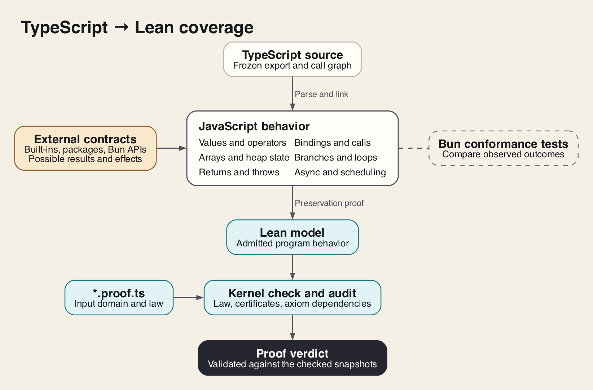

# TypeScript-to-Lean coverage map

> [!WARNING]
> This note was written by an LLM. Its content may be hard to read as a result. Feel free to [open a PR](https://github.com/rorz/pud/compare) to fix this note. [[First Mate's Log/about-the-first-mates-log#Why keep these notes?|Read more here]] on the rationale behind AI-generated notes.

What has to be covered for a proof about a TypeScript export to mean the same thing when Bun runs it? The map follows the implementation and its sidecar into Lean. The dashed connection records runtime comparison tests. The preservation step is a proof obligation on the translation.

[](../../../../img/verification/lean/typescript-to-lean-coverage-map.png)

## Define the scope of a claim

A coverage target needs a fixed language and runtime profile. Record the compiler or transpiler settings, Bun and Lean versions, module resolution, admitted input shapes, and allowed runtime bindings. Type annotations describe the intended inputs. Runtime checks or stated assumptions establish that concrete calls have those inputs. The law also needs to say what a run can observe, such as a returned value, thrown value, state change, I/O event, or termination. [Type erasure](https://www.typescriptlang.org/docs/handbook/2/basic-types.html#erased-types) · [TypeScript compiler options](https://www.typescriptlang.org/tsconfig/)

The table inventories semantic families. Each row still needs cases for its combinations with the other rows.

| Area | What Pud needs to model | Where the Lean adapter is today |
| --- | --- | --- |
| TypeScript source and emit | Syntax, binding and scope, erased types, JSX and runtime-emitting features such as enums and decorators. Match the actual transpiler and settings. | Parses a restricted TypeScript shape and uses explicit types for admitted values. Full emit correspondence is open. |
| Modules and dependencies | Import resolution and aliases, initialization order, live bindings, cycles, package exports, ESM/CJS interop, and the exact resolved source graph. | Follows selected named relative imports with inert initialization and rechecks snapshots. Package and dynamic linking are outside that path. |
| Values and operators | `undefined`, `null`, booleans, strings, symbols, BigInt, IEEE-754 Number, coercion, comparisons, bit operations, and exceptional cases. | BigInt and boolean expressions, including signed division, remainder, and their modeled throws. General Number and string operations are gaps. |
| References and evaluation order | Local and captured state, evaluation order, short-circuiting, binding identity, assignment targets, updates, destructuring, and abrupt operands. | Scalar locals, assignment, and selected expressions. Some rules have an independent scalar preservation certificate. |
| Arrays, objects, and heap | Length and indexed reads, bounds, holes, iterators, records, reference identity, aliases, mutation, properties, getters, prototypes, classes, and proxies. | Dense lists for a subset of readonly arrays and a narrow opaque-record case. Indexed reads and general heap behavior are gaps. |
| Control flow and completion | Branches, switches, counted loops, iteration, early exits, returns, throws, catch bindings, and the ordering of `finally`. Termination evidence where promised. | Branches, `for…of`, restricted countdown loops and recursion, and a narrow unbound catch. The indexed `for` is rejected. |
| Calls and closures | Argument order, defaults and spread, function values, lexical capture, receiver binding, construction, recursion, and cross-module contracts. | Direct calls to supported named functions and selected recursion. Higher-order calls and general method dispatch are gaps. |
| ECMAScript library | Array callbacks and iterator rules, strings and regular expressions, maps and sets, typed arrays, numeric functions, and reflection. | A few special operations. Each admitted built-in needs a model or contract tied to its binding. |
| Host effects and external code | Console, clocks, randomness, file/network/database calls, process state, and native code. A contract describes allowed outputs, throws, state changes, and whether the call finishes. | The linker expects modeled source for ordinary calls. Standalone logging is rejected during lowering. |
| Asynchrony and concurrency | Promises, rejection, async iteration, generators, scheduling, cancellation, workers, and shared memory. | Synchronous functions only. |
| Properties and proof | Input preconditions, normal and exceptional outcomes, invariants, frames, termination, and reusable laws over the declared observations. | Sidecar predicates, quantified refinements, modeled throw expectations, and native proof terms. Return matchers require a successful return. |
| Translation and assurance | Faithful source reification, binding and emit correspondence, preservation of each observation, verified call contracts, and auditing the law against the frozen inputs. | Kernel-checked model laws, scalar certificates where available, selected loop certificates, and snapshot validation. The complete TypeScript-to-Bun correspondence is open. |

The ECMAScript specification is the inventory for language operations and standard built-ins. TypeScript emit and host behavior add their own obligations. For example, the console standard leaves printing behavior to the implementation. [ECMAScript](https://tc39.es/ecma262/) · [Console printing](https://console.spec.whatwg.org/#printer) · [[First Mate's Log/Verification/Lean/configured-proof-assistant-adapters#Road to semantic preservation|Current preservation evidence]]

## Indexed traversal is one coverage milestone

The indexed loop from the working-tree `sumPositive` example makes several rows meet in one function.

```ts
let total = 0n;
for (let i = 0; i <= values.length; i++) {
  const value = values[i];
  if (value && value > 0n) {
    total += value;
  }
}
return total;
```

| Source behavior | Evidence needed |
| --- | --- |
| `let i = 0`, `i++`, and `i <= values.length` | A model for JS Number indices in the admitted range, array length, and a counted loop whose measure decreases. For a fixed-length array, the extra iteration at `i === length` is part of the model. |
| `const value = values[i]` | An indexed lookup that yields a bigint or `undefined` under the dense-array assumptions. At the upper boundary, the read has the latter outcome. |
| `value && value > 0n` | Truthiness and short-circuiting. The guard skips `undefined` and zero and tests the sign of the remaining values. |
| `total += value` and `return total` | A proof that the initial zero and each executed step preserve `total >= 0n`, and that the final return reads that total. |

Pud currently stops at the `ForStatement`. Isolated probes reject the Number literal, `.length`, and index access as well. With plain dense arrays, standard prototypes, and stable length, the extra read yields `undefined` and the guard skips the addition. The invariant above can establish the property for either traversal spelling. An equality to a reference sum is a stronger law. [Sidecar](https://github.com/rorz/pud/blob/main/packages/cli/experiments/lean/.examples/sum-positive.proof.ts) · [Indexed access typing](https://www.typescriptlang.org/tsconfig/#noUncheckedIndexedAccess)

## Logging exercises the same call boundary as other effects

A model of `console.log(total)` has to identify the logger binding and account for argument evaluation before the call. Its contract can describe the possible normal and throwing outcomes and what state the call may change. The verifier must establish the requested law across the outcomes the contract admits. A law about successful returns can hold when a logger may throw. A law that promises a normal return on every admitted input also needs evidence that exceptional and nonterminating paths are excluded. [[First Mate's Log/Verification/Lean/measuring-typescript-to-lean-coverage#Use logging to exercise external calls|External-call coverage notes]]

## What counts as covered

| Evidence | What to record |
| --- | --- |
| Admission | Cases lowered out of a pinned corpus, with the first blocker for every rejection. |
| Runtime comparison | Cases whose selected observations agree between Bun and the model. Include boundary inputs and interactions such as a throwing argument or a return through `finally`. |
| Preservation | Rules and combinations with checked evidence that modeled source execution and the generated Lean program agree on the declared observations. With several possible outcomes, the model must include every runtime outcome allowed by the assumptions. |
| Property proof | Sidecar laws accepted by the kernel and axiom audit for the exact source and dependency snapshots. Include equivalent implementations using the same sidecar and a mutation that violates the law. |

Use Test262 cases for ECMAScript behavior, TypeScript compiler cases for source and emit, and project fixtures for host contracts and end-to-end laws. The last broad repo scan admitted **0 of 187 named exports**. Imports or module setup accounted for **122 first rejections**. The earlier curated demo certified 32 active laws with the supported `for…of` version of `sumPositive`. Keep the corpus and its denominator with the result. [Test262](https://github.com/tc39/test262) · [[First Mate's Log/Verification/Lean/measuring-typescript-to-lean-coverage#What the current adapter admits|Repo coverage scan]]

## Proposed build order

1. **Pin a synchronous data-processing profile.** Start with scalar logic, dense arrays, bounded integer indices, explicit return and throw outcomes, and resolved calls. Use shared state and completion rules for the admitted statement forms.
2. **Finish indexed traversal end to end.** Check the same nonnegativity sidecar against `for…of` and counted loops. Include empty arrays, zero and negative elements, the extra boundary read, and a reversed-guard mutation. Generate the invariant obligations from the current program.
3. **Model external calls through their contracts.** Use logging as the first case. Exercise normal return, propagated throw, handled throw, and an unknown or shadowed binding. Reuse the outcome model as more host calls are admitted.
4. **Expand the profile with evidence.** Add common value, heap, module, and standard-library behavior in groups that compose. Allocate separate runtime profiles and evidence for scheduling, shared state, and dynamic code.

The reusable interface is the law and its input domain. Every implementation supplies fresh evidence for that law through the same semantics. [[Handbook/Engineering/Verification/Lean/checking-typescript-with-lean|Checking TypeScript with Lean]]
