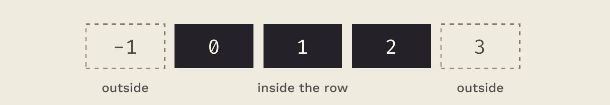
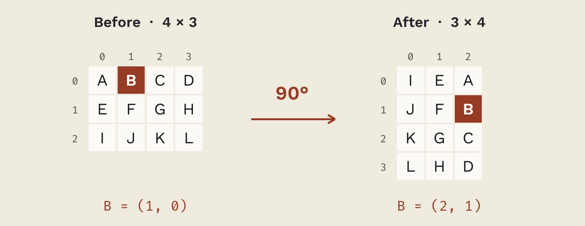
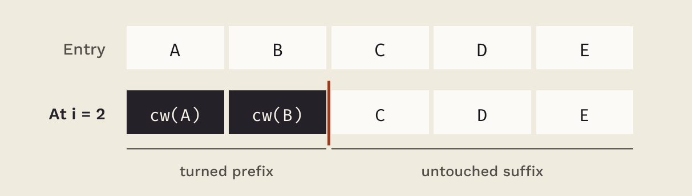
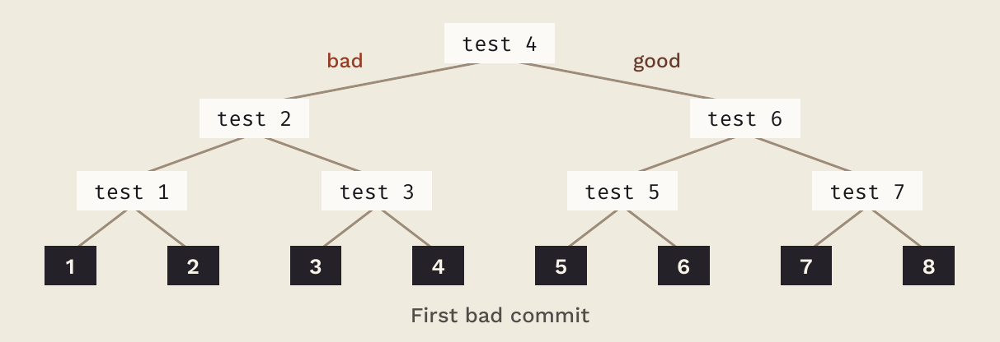

# The Software Engineer’s Introduction to Formal Verification

*First edition. Worked proofs in Lean, Rocq, and Dafny.*

Rotate a rectangular image clockwise through 90 degrees. A pixel on the last row has to move to the first column. Which position in that column belongs to it? How do you know a second pixel won’t land there too?

Formal verification lets you turn an answer such as “every valid address stays inside the image” into a mathematical claim a computer can check. We’ll start with the symbols, prove the claim on paper, then try it in three tools.

## Contents

1. [How to read a claim](#chapter-01)
2. [Draw the specification](#chapter-02)
3. [A proof on paper](#chapter-03)
4. [What counts as verification?](#chapter-04)
5. [Lean](#chapter-05)
6. [Rocq](#chapter-06)
7. [Dafny](#chapter-07)
8. [When a proof fails](#chapter-08)
9. [From a function to a system](#chapter-09)
10. [Read a page of mathematics](#chapter-10)
11. [The workbench](#chapter-11)
12. [Desk reference](#chapter-12)

<a id="chapter-01"></a>

## 1. How to read a claim

### A name, a set, a sentence

Draw three little boxes in a row. Number them 0, 1, 2. An engineer sees three array slots. A mathematician might write `X = {0, 1, 2}`. The braces collect the permitted values into a **set**. The order in which you list a set’s members makes no difference. The box numbers themselves still determine positions.



The expression `2 ∈ X` reads “two belongs to X.” It makes a claim that is true. So does `2 < 3`. The expression `3 ∈ X` makes a claim that is false. Either kind of claim is called a **proposition**. A plain value such as `2` has a different job. You can add one to it. You can ask whether a proposition holds.

Now give the row a variable width, `w`. We’ll use **integers**, the numbers `…, -2, -1, 0, 1, 2, …`. Their usual symbol is `ℤ`. The **natural numbers**, written `ℕ` here, are `0, 1, 2, …`. Choosing between them changes the arithmetic available to a proof. On integers, `0 - 1 = -1`. In Lean and Rocq, subtracting one from zero in the *natural numbers* instead gives zero.

> `0 ≤ x ∧ x < w`

Read this aloud once. “Zero is at most x, **and** x is less than w.” The symbol `∧` holds two claims together. A compact spelling is `0 ≤ x < w`. A **predicate** gives this sentence a name and a parameter. Call it `InRow(w, x)`. For width three you can settle any particular case with two comparisons. Try `x = -1` and `x = 2`. Only the second passes.

### Every, some, and the order of the words

One index inside a row of width three settles the claim “there exists a valid index.” Choose 2 and check `0 ≤ 2 < 3`. The index is a **witness**. To show that *every* valid index stays in range when reversed, the argument must work even if someone else chooses the index.

Mathematicians shorten **for every** to `∀` and **there exists** to `∃`. Read the symbols from left to right. A bound variable lasts for the sentence that follows it, much as a function parameter lasts for the body.

> `∀ x ∈ ℤ, ∃ y ∈ ℤ, y > x`

Choose any integer `x`. The integer `x + 1` is larger. That one rule supplies a witness however large the input is. Reverse the order and you get `∃ y ∈ ℤ, ∀ x ∈ ℤ, y > x`. Now y must be chosen before x. For every proposed y, choose `x = y`. That choice would require `y > y`. A **counterexample** is a case that breaks a claim. Here the rule produces one for each proposed y.

One more bit of punctuation. `P → Q` reads “if P holds, Q follows.” A counterexample needs P true and Q false. An input with P false makes no demand on Q. `P ↔ Q` asks for *both* directions. A decoder that accepts only valid indices may still reject a valid one. Saying it accepts an index *if and only if* it is valid also commits the decoder to accepting every valid index. [Quantifiers and equality](https://lean-lang.org/theorem_proving_in_lean4/Quantifiers-and-Equality/)

<a id="chapter-02"></a>

## 2. Draw the specification

### Where does the top row go?

Take a raster four pixels wide and three high, with one byte per pixel. Give the bytes distinct values so that the three rows read ABCD, EFGH and IJKL. The origin is the top left, x increases to the right, and y increases downwards. A point `(x, y)` is an **ordered pair**. Swapping its components usually picks a different address. Follow B through a clockwise quarter turn.



The new rows read IEA, JFB, KGC and LHD. The old top row becomes the new right column. The bottom row becomes the left column. Old row numbers 0, 1, 2 become new column numbers 2, 1, 0. To reverse a zero-based range of height `h`, subtract the old index from its last index, `h - 1`. Meanwhile old column 1 becomes new row 1. That gives the whole formula.

> `cw(h, (x, y)) = (h - 1 - y, x)`

Here `cw` names the function and `=` declares equal values. Its first argument is the **old height**. The width matters when you describe which inputs are valid. The coordinate calculation itself only needs the height. Keep a non-square sketch beside the code. On a square, interchanging the width and height leaves both numbers looking right. Pillow uses the same top-left coordinate convention. Its `Transpose.ROTATE_270` gives the clockwise quarter turn in the drawing. [Pillow coordinates](https://pillow.readthedocs.io/en/stable/handbook/concepts.html#coordinate-system) · [Pillow geometric transforms](https://pillow.readthedocs.io/en/stable/handbook/tutorial.html#geometrical-transforms)

### Which promises describe the turn?

A **specification** says what an implementation owes its caller. Start with a modest promise. A valid address before the turn should map to a valid address afterwards. Give “inside the raster” a name.

```text
Inside(w, h, (x, y)) = (0 ≤ x < w) ∧ (0 ≤ y < h)
```

Now the promise fits on two lines. The variables range over integer widths, integer heights and integer points. `p` is shorthand for a whole point.

```text
∀ w, h, p,
  Inside(w, h, p) → Inside(h, w, cw(h, p))
```

Pick any width, height and point. Assume the point is inside the raster. Show that its new address is inside the raster of **swapped** dimensions. For `w = 4`, `h = 3` and `p = (1, 0)`, the conclusion is `Inside(3, 4, (2, 1))`. When a dimension is zero there is no valid input point, so the implication leaves the treatment of an empty image to the API.

Could a broken turn satisfy this promise? Put every point at `(0, 0)`. Whenever the input contains a valid point both dimensions are positive, so the origin is valid in the turned image too. Add a second promise about undo recovering each original position. Keep a labelled drawing as well. In chapter 8, even those two promises will let a reflection through.

A pixel also has a byte value. Keep the input intact during the turn. In row-first notation the required copy is `output[x][h - 1 - y] = input[y][x]` for each valid source. On a two-by-two raster with rows AB and CD, copying A directly into B’s slot loses B before a row-by-row scan reads it. Copying into fresh storage gives the rows CA and DB. The point theorems establish where a byte belongs. The copy loop has to put its original value there. [TypeScript pixel copy](examples.ts)

<a id="chapter-03"></a>

## 3. A proof on paper

### The four inequalities

A proof starts by choosing an arbitrary valid input. “Arbitrary” means you never get to smuggle in the width four or the height three. The only facts you may use about this point are the ones in the premise. Unpack it and you get four.

```text
0 ≤ x       x < w       0 ≤ y       y < h
```

The new point is `(h - 1 - y, x)`. To establish its validity on an `h`-wide, `w`-high raster, check the following four obligations.

| What we owe | Why it follows |
| --- | --- |
| `0 ≤ h - 1 - y` | Since `y` and `h` are integers, `y < h` gives `y ≤ h - 1`. Subtract `y`. |
| `h - 1 - y < h` | From `y ≥ 0` we get `h - 1 - y ≤ h - 1`, and `h - 1 < h`. |
| `0 ≤ x` | The original x lower bound already says this. |
| `x < w` | The original x upper bound already says this. |

That is a complete argument for every valid integer point. The first row contains the one step worth circling. There is no integer strictly between `h - 1` and `h`. If these were continuous canvas coordinates, `h = 3` and `y = 2.5` would pass the input check, yet the new x coordinate would be `-0.5`. Your choice of number system did real work.

These steps use **linear arithmetic**. Adding variables or multiplying one by a fixed number, as in `2 × y`, stays linear. Multiplying two unknowns, as in `w × h`, takes us beyond it.

A **lemma** is a proved fact you mean to reuse. A **theorem** is a proved result you want to name. The distinction is editorial. A checker can use either as a dependency.

### How undo becomes algebra

Draw the inverse arrow from the turned image back to the original. If the turned point is `(u, v)`, you already know the original x was `v`. Reversing a zero-based index a second time restores the original y. Write the inverse with the **same** height parameter. In the turned image that number is its width.

```text
ccw(h, (u, v)) = (v, h - 1 - u)
```

Function calls nest just as they do in code. To see what `ccw(h, cw(h, p))` does, substitute the result of the inner call into the outer one, then simplify.

```text
p                       = (x, y)
cw(h, p)                = (h - 1 - y, x)
ccw(h, cw(h, p))        = (x, h - 1 - (h - 1 - y))
                        = (x, y)
```

For the last equality, temporarily name `h - 1` as `m`. Expand the minus in `m - (m - y)` and you get `m - m + y = y`. The x components were already equal. Two points are equal when both of their corresponding components are equal.

Look back for the step that used `Inside`. There wasn’t one. The round trip works for *all* integer points, even `(-40, 600)`. That makes this lemma easier to call. It also gives two independent questions for a reviewer. Does a turn keep a valid address in bounds? Can the original coordinates be recovered exactly? One theorem answers each question.

<a id="chapter-04"></a>

## 4. What counts as verification?

### What did the experiment cover?

**Formal verification** means establishing that a formally described system satisfies a precisely stated property, using mathematical reasoning. Our paper proof contains the reasoning. A machine-checked version also pins down the types, definitions and allowed steps precisely enough for a checker to reject a missing step.

Suppose a unit test rotates the twelve-byte image and checks where B lands. You gain evidence about that execution, including the coordinate conversion and the byte copy. A property-based test can generate rectangles and points and check bounds after every turn. A failing input is valuable at any sample size. A passing run covers the inputs it selected. A loop over all twelve pixels settles the coordinate question for this fixed raster if it faithfully computes the intended predicate.

The symbolic proof in chapter 3 handles every integer width and height at once. Its economy comes from using the same inequalities regardless of raster size. An end-to-end test can catch an error in decoding, copying or displaying the bytes, all of which lie outside the point theorem.

A **model checker** offers another route. Give it states, allowed transitions and a property. An explicit-state checker such as TLC can exhaust the reachable states of a finite configuration and show a trace leading to a bad one. A run configured for one transfer and two account reads has exactly that scope. In chapter 9 we’ll draw such a history by hand. [Lamport on the TLA+ tools](https://lamport.azurewebsites.net/tla/tools.html)

### A contract at a call site

The caller must supply a valid address. The callee may take that as given and must return a valid result. The fact supplied at entry is a **precondition**. The fact promised at return is a **postcondition**. A checked call lets the next function use the postcondition as one of its own facts. This is how you avoid reopening an implementation at every use.

You may see a **Hoare triple** written `{P} C {Q}`. Read from left to right. Starting in a state satisfying P, executing command C establishes Q on normal termination. In its usual *partial correctness* reading, a command that runs forever never reaches an exit where Q is owed. A *total correctness* argument also proves termination. Our functions do a fixed amount of arithmetic. A batch edit with a loop will need more thought. [Hoare logic in Software Foundations](https://softwarefoundations.cis.upenn.edu/plf-current/Hoare.html)

Try reviewing a familiar signature with a contract in mind. A TypeScript `{x: number, y: number}` admits fractional values and values such as `NaN`. Our integer theorem quantifies over a different domain. A parser could check integer inputs and their bounds, then use arithmetic exact over the supported range. A cast in a TypeScript file supplies none of that evidence.

An API has a choice when a sampling request lands outside the image. It can reject the request, return an optional value or clamp the address to the edge. The formula for a valid address leaves that decision to the caller.

<a id="chapter-05"></a>

## 5. Lean

### A value and the evidence for a claim

Lean is a programming language and an interactive theorem prover. You can define a point, compute its image and state a claim about all such computations in the same file. Read this excerpt top to bottom. A `structure` declares a record. `Int` gives its fields signed, arbitrary-precision integer values. `def` names a definition. The symbol `:=` introduces its body.

```lean
structure Pt where
  x : Int
  y : Int
  deriving Repr, DecidableEq

def Inside (w h : Int) (p : Pt) : Prop :=
  (0 ≤ p.x ∧ p.x < w) ∧ (0 ≤ p.y ∧ p.y < h)

def cw (h : Int) (p : Pt) : Pt :=
  ⟨h - 1 - p.y, p.x⟩
```

`(p : Pt)` means that `p` has type `Pt`. Application uses spaces, so `cw h p` is the call an engineer might write `cw(h, p)`. The angle brackets construct the record whose type Lean expects. `deriving` gives us a way to display points and decide equality between two concrete points.

Notice the return types. `cw` produces a `Pt`. `Inside w h p` is a proposition of type `Prop`. A proof of `Inside w h p` is a value whose **type is that very proposition**. A function that takes such evidence and returns evidence of the rotated point’s validity is an implication made usable as code. This idea is called *propositions as types*, also known as the Curry–Howard correspondence. [Propositions and proofs](https://lean-lang.org/theorem_proving_in_lean4/Propositions-and-Proofs/)

```lean
example : cw 3 ⟨1, 0⟩ = ⟨2, 1⟩ := rfl
```

The little `example` is one checked calculation. `rfl` proves equality when the two sides reduce to the same thing. In an editor, change the expected point to `⟨1, 2⟩` and the type checker objects.

### What the goal window is telling you

```lean
theorem cw_inside {w h : Int} {p : Pt}
    (hp : Inside w h p) : Inside h w (cw h p) := by
  rcases hp with ⟨⟨hx0, hxw⟩, ⟨hy0, hyh⟩⟩
  change (0 ≤ h - 1 - p.y ∧ h - 1 - p.y < h) ∧
         (0 ≤ p.x ∧ p.x < w)
  constructor
  · constructor <;> omega
  · exact ⟨hx0, hxw⟩
```

Read the theorem’s signature as an API. The parameters in braces can be inferred from later arguments. `hp` is a named piece of evidence for the input predicate. After the colon is the evidence we owe the caller. `by` starts a tactic script. A **tactic** builds part of a proof, often by turning one goal into smaller ones. A small component called the **kernel** type-checks the proof term those tactics build. [Tactics](https://lean-lang.org/theorem_proving_in_lean4/Tactics/) · [The Lean kernel](https://lean-lang.org/doc/reference/latest/Elaboration-and-Compilation/)

`rcases` destructures the nested conjunction in `hp` into four named facts. `change` asks Lean to unfold enough definitions to see the same goal in coordinate form. `constructor` splits an “and” into its two obligations. The dots mark the two branches. In the first branch, `<;>` runs `omega` on each goal produced by the inner split. Here `omega` handles linear integer arithmetic.

Stop just before the last line and the relevant part of the goal window reads like this.

```text
hx0 : 0 ≤ p.x             hxw : p.x < w
⊢ 0 ≤ p.x ∧ p.x < w
```

The turnstile `⊢` means “what remains to show.” Above it are things you have. After it is the thing you need. `exact ⟨hx0, hxw⟩` packages the two existing facts in precisely that order. This is the third and fourth row of the paper proof.

### An address that carries its bounds

Suppose a sampler has already validated a pixel address. You could keep passing the raw coordinates and proving bounds again. Lean lets you put the coordinates and their bounds in a type.

```lean
structure Cell (w h : Int) where
  point : Pt
  valid : Inside w h point

def rotateCell {w h : Int} (c : Cell w h) : Cell h w :=
  ⟨cw h c.point, cw_inside c.valid⟩
```

`Cell 4 3` is a type of points equipped with evidence that they fit dimensions four by three. Two different images of those dimensions accept the same cell. The type carries an address and its bounds. `Cell 3 4` describes a different space. This is a **dependent type**. Values such as `4` and `3` appear inside a type, and the type of the `valid` field depends on the value of the preceding `point` field. Try constructing a `Cell 4 3` with x equal to 4. The proof field would require evidence of `4 < 4`.

The implementation of `rotateCell` is a two-field constructor. Its first field computes a point. For the second, `c.valid` supplies the precondition of `cw_inside`. The theorem returns exactly the evidence required by the output type. If you accidentally announce the result as `Cell w h`, the two dimensions in the theorem’s result no longer line up.

A TypeScript branded type may feel familiar here. Its constructor can carry the convention that validation happened. In the Lean definition the exact proposition sits in the record type, and the checker follows it through this call. A parser receiving untrusted coordinates still needs to decide the bounds before it can produce the record. Proof fields in `Prop` are erased from compiled Lean code. [Dependent types](https://lean-lang.org/theorem_proving_in_lean4/Dependent-Type-Theory/) · [Propositions in compiled code](https://lean-lang.org/doc/reference/latest/The-Type-System/Propositions/)

### Why two source addresses cannot merge

If two source addresses have the same destination, they must have started at the same point. Mathematicians call a function with this property **injective**. It matters when each input byte needs its own output slot.

```lean
theorem no_merge (h : Int) (p q : Pt)
    (same : cw h p = cw h q) : p = q := by
  have back := congrArg (ccw h) same
  simpa only [undo_cw] using back
```

Line one of the body applies a function to both sides of an equality. The function is `ccw h`, with one argument already filled in. If `same` says the destinations agree, `back` has this type.

```text
ccw h (cw h p) = ccw h (cw h q)
```

The lemma `undo_cw`, proved in the companion file by the cancellation from chapter 3, rewrites the left side to `p` and the right side to `q`. Read `simpa only [undo_cw] using back` as “simplify the type of this evidence with the undo lemma and use the result.” We just derived a new property without reopening the coordinate formula. A change of coordinate representation would leave this argument intact if the new implementation kept the same undo law.

An **axiom** is a statement taken as a starting assumption. To see which axioms a theorem uses, run `#print axioms no_merge`. With the supplied Lean version this lists `propext` and `Quot.sound`, foundational principles about equivalent propositions and quotient types used by dependencies of the proof. Lean also accepts `sorry` as a proof placeholder and reports `sorryAx` for a theorem that depends on it. The companion checks its named results and their dependencies. [Axioms and computation](https://lean-lang.org/theorem_proving_in_lean4/Axioms-and-Computation/)

<a id="chapter-06"></a>

## 6. Rocq

### A computation in Gallina

Rocq, formerly Coq, has a language for terms and definitions called **Gallina**. We’ll keep the coordinate system and change the thing we want to learn. After checking one rotation, we’ll prove that undo restores an entire trace of sampled addresses, including their ordering and any repeated visits. [The Rocq Prover](https://rocq-prover.org/)

```coq
From Stdlib Require Import ZArith Lia List.
Import ListNotations.
Open Scope Z_scope.

Record Pt := pt { px : Z; py : Z }.

Definition inside (w h : Z) (p : Pt) : Prop :=
  (0 <= px p < w) /\ (0 <= py p < h).

Definition cw (h : Z) (p : Pt) : Pt :=
  pt (h - 1 - py p) (px p).

Definition ccw (h : Z) (q : Pt) : Pt :=
  pt (py q) (h - 1 - px q).

Example turn_one : cw 3 (pt 1 0) = pt 2 1.
Proof. reflexivity. Qed.
```

`Z` is the standard library’s integer type. `Open Scope Z_scope` gives numerals and arithmetic signs their integer interpretation here. The record name is `Pt`. Lowercase `pt` is its constructor. `px` and `py` are projections, so `py p` reads the y field of `p`. `/\` is how this source spells mathematical “and.” Each command ends with a period.

`Example turn_one` names the evidence for the stated equality. `Proof.` enters interactive proof mode. `reflexivity.` asks whether the two sides of the equality compute to the same point. `Qed.` closes the proof and saves the theorem. Enter `Check turn_one.` to see that equality as its type. Checking the equality expression itself gives `Prop`.

### Splitting a proposition

```coq
Theorem cw_inside : forall w h p,
  inside w h p -> inside h w (cw h p).
Proof.
  intros w h [x y] [[Hx0 Hxw] [Hy0 Hyh]].
  cbn [px py] in Hx0, Hxw, Hy0, Hyh.
  change ((0 <= h - 1 - y < h) /\ (0 <= x < w)).
  split.
  - split; lia.
  - exact (conj Hx0 Hxw).
Qed.
```

`forall` binds the three inputs. The arrow takes evidence of input validity to evidence of output validity. `intros` introduces the inputs and the premise. The pattern `[x y]` opens the point record. The nested square brackets take apart the two coordinate bounds. It is the proof-language cousin of destructuring an object parameter.

`cbn [px py] in ...` simplifies the projections in the four facts. For example the x projection of `pt x y` reduces to `x`, leaving `Hxw` as evidence for `x < w`. `change` presents the goal with the definitions expanded. The first `split` leaves one goal for each coordinate. In the first bullet, `split; lia.` breaks the chained inequality into two goals and applies the linear integer arithmetic tactic to both.

In the second bullet the answer is already on the desk. `conj Hx0 Hxw` constructs a proof of the conjunction about x. `exact` hands it to Rocq. The tactics have built a proof term which the kernel checks. `Print Assumptions cw_inside.` asks which assumptions it uses. In the supplied file Rocq reports “Closed under the global context.” `Admitted.` would create an assumption that downstream results can inherit. [Rocq proof commands](https://rocq-prover.org/doc/V9.3.0/refman/proof-engine/vernacular-commands.html)

### A list of sampled addresses

A sampler can record a trace that visits A, then B, then A again. Model the trace as a list. A list has two possible shapes. It is empty, `[]`, or it consists of a first item `p` attached to another list `tail`. Rocq spells that second shape `p :: tail`. These are **constructors**, the ways a list value can be built. They suggest the shape of both a program and a proof.

```coq
Fixpoint turnAll (h : Z) (ps : list Pt) : list Pt :=
  match ps with
  | [] => []
  | p :: tail => cw h p :: turnAll h tail
  end.
```

`Fixpoint` introduces a recursive definition. The empty trace turns into an empty trace. In the other branch, rotate its first point, recurse on the tail and keep their order. The recursive call receives an actual subpart of the original value. Rocq’s structural termination check can see that each call peels off one constructor. Give it `ps` again in that call and this definition would lack that decrease.

Apply the definition once to `[A, B]`. It emits the image of A and calls itself on `[B]`. That call emits the image of B and calls itself on `[]`. The last call returns `[]`. A library function, `map f`, captures this same element-by-element pattern for any `f`. That gives us a concise specification for undoing the batch.

> `map (ccw h) (turnAll h ps) = ps`

List equality commits to length, values and order. Comparing sets could miss a reversed trace or the loss of a repeated visit. Rocq can also extract a computational definition such as `turnAll` to OCaml. Relying on that executable adds the extraction step and target compiler to the path you trust. [Rocq’s extraction mechanism](https://rocq-prover.org/doc/V9.3.0/refman/addendum/extraction.html)

### Induction, one line at a time

```coq
Theorem undo_all : forall h ps,
  map (ccw h) (turnAll h ps) = ps.
Proof.
  intros h ps.
  induction ps as [| p tail IH].
  - reflexivity.
  - cbn [turnAll map].
    rewrite undo_cw, IH.
    reflexivity.
Qed.
```

A **structural induction** proves something for every list by covering the ways lists are built. The first bullet handles the empty list. Both sides compute to `[]`. In the second bullet the input is `p :: tail`. Rocq gives the name `IH` to the **induction hypothesis** that the theorem already holds for the smaller `tail`. This is the logical counterpart of receiving the recursive call’s result.

After `cbn` opens one layer of `turnAll` and `map`, the remaining equation has this shape.

```text
ccw h (cw h p) :: map (ccw h) (turnAll h tail)
= p :: tail
```

`rewrite undo_cw` restores the head. Rewriting by `IH` restores the tail. Now `reflexivity` closes an equality whose two sides are literally the same list. The proof has one step for a constructor regardless of how long a future trace will be. It needs no maximum list length.

To see why the hypothesis is legitimate, imagine constructing any particular finite list from the empty list by adding its heads, starting with its last element. The base proof covers the first stage. The step proof extends each proved stage by one head. Every finite list is reached that way. This is a good reading of “by induction” when a paper skips directly to the two cases. [Induction in Software Foundations](https://softwarefoundations.cis.upenn.edu/lf-current/Induction.html)

<a id="chapter-07"></a>

## 7. Dafny

### Contracts the solver can use

Dafny looks familiar if you write imperative software. You can declare pure functions for the mathematics, methods for state changes, and lemmas for facts you want the verifier to establish. The point is a `datatype` with an integer x and y. Here is the forward half of the specification.

```dafny
predicate Inside(w: int, h: int, p: Pt)
{
  0 <= p.x < w && 0 <= p.y < h
}

function Cw(h: int, p: Pt): Pt
{
  Pt(h - 1 - p.y, p.x)
}
```

```dafny
lemma CwInside(w: int, h: int, p: Pt)
  requires Inside(w, h, p)
  ensures Inside(h, w, Cw(h, p))
{
}
```

`requires` introduces a fact the caller must supply. `ensures` is what the lemma delivers. The empty pair of braces supplies a body. Dafny still has to establish the postcondition and can do it automatically with these function definitions and the arithmetic facts. The companion file gives `UndoCw` its own contract in the same style.

Dafny translates the proof obligations through Boogie and asks the Z3 solver to discharge them. **SMT** stands for satisfiability modulo theories. Here the solver reasons using the rules of integers and datatypes. It can work with symbolic coordinates of arbitrary size. An `assume` statement would grant a fact without requiring a proof there. Adding one to silence an error changes what later checks rely on. [Dafny’s verification guide](https://dafny.org/v4.11.0/VerificationOptimization/VerificationOptimization) · [Dafny language reference](https://dafny.org/v4.11.0/DafnyRef/DafnyRef)

### Read the verification condition

A **verification condition** is a logical obligation produced from the source. For the new x coordinate’s upper bound, the obligation reduces to this little question. Could all of the following be true at the same time?

```text
0 ≤ x < w
0 ≤ y < h
h - 1 - y ≥ h
```

The first two lines are the hypothesis. The last line is the **negation** of the goal. If `h - 1 - y ≥ h`, then subtracting `h` from each side gives `-1 - y ≥ 0`, hence `y ≤ -1`. That conflicts with `0 ≤ y`. There is no assignment of integers satisfying the whole set. Solver terminology calls it **unsatisfiable**. Ruling out the counterexample establishes the implication. This is one obligation unpacked by hand. The actual tool can group several together.

Now remove the `- 1` from the implementation. The last line becomes `h - y ≥ h`. Set `w = 1`, `h = 1` and `x = y = 0`. All three lines hold. With the changed formula, the only pixel lands at `(1, 0)` in an image that has only column zero. You can draw that witness in the margin.

For larger obligations a timeout or inconclusive result can mean the solver needs a usable intermediate fact. An `assert` asks Dafny to prove such a fact at that point, then makes it available below. A lemma packages a fact for reuse. Either can expose exactly where the arithmetic stops following. [Verification optimization](https://dafny.org/v4.11.0/VerificationOptimization/VerificationOptimization)

Why can a checker ever answer “unknown”? Even the question “will this program terminate on this input?” has no algorithm that always returns the correct yes or no for arbitrary programs. This is the *halting problem*. Narrower questions can be decidable. Our linear inequalities are one such case. [MIT’s lecture on computability](https://ocw.mit.edu/courses/6-006-introduction-to-algorithms-fall-2011/a2ee5c645c0c690e76f5d0db4807edcd_moPtwq_cVH8.pdf)

### A sample trace updated in place

A sampler may keep its trace of pixel addresses in a mutable array. A caller might hold a second reference to that same array. The method changes the coordinates in each trace slot. The pixel bytes live in a separate buffer. Here is the method’s contract.

```dafny
method TurnInPlace(h: int, a: array<Pt>)
  modifies a
  ensures forall k :: 0 <= k < a.Length ==>
    a[k] == Cw(h, old(a[k]))
```

`modifies a` is a **frame** clause. It allows writes to the array object. Other pre-existing heap objects lie outside this method’s write permission. Both references to the array see the update. `old(a[k])` in the postcondition reads element k from the heap at method entry. Quantifying over `k` ties *each final slot* to *its own initial value*. This contract covers a trace with repeated points. It transforms coordinates regardless of whether the points fall within any particular raster dimensions.



At the top of the loop, picture one boundary between finished slots and untouched slots. At `i = 0` the finished portion is empty. At `i = a.Length` it is the whole array. A **loop invariant** describes what must be true each time control reaches this boundary. Can you state both sides of the drawing in words before looking at the code?

### The fact the loop forgets

```dafny
{
  ghost var before := a[..];
  var i := 0;
  while i < a.Length
    invariant 0 <= i <= a.Length
    invariant forall k :: 0 <= k < i ==>
      a[k] == Cw(h, before[k])
    invariant forall k :: i <= k < a.Length ==>
      a[k] == before[k]
    decreases a.Length - i
  {
    a[i] := Cw(h, a[i]);
    i := i + 1;
  }
}
```

`before` is a **ghost** variable bound to a sequence snapshot of the entry array. The snapshot is immutable. Dafny uses it to check the proof and erases the ghost variable when compiling executable code. The first invariant makes the index safe under the loop guard. The next two define the finished prefix and untouched suffix in the diagram.

**Entry.** The prefix is empty, and the snapshot has just been taken. **Step.** At slot i the suffix invariant tells us the array still contains `before[i]`. After one assignment the slot contains its required turn. The write affects only slot i, so the older prefix keeps its turned values and the rest of the suffix keeps its entry values. Incrementing i grows the finished region by exactly one slot. Since indices are integers, `i < a.Length` gives `i + 1 ≤ a.Length`. **Exit.** The guard is false, and the bounds invariant implies `i = a.Length`. The prefix property now covers every slot.

`decreases a.Length - i` accounts for termination. While the guard is true it is a positive integer, and each step reduces it by one. Remove the suffix invariant and the verifier loses the fact that the *next* point still has its entry value. The loop body is unchanged. The preservation proof for the growing prefix then fails. This is a particularly instructive failure to try on a copy of the file. [Dafny on loops and termination](https://dafny.org/v4.11.0/OnlineTutorial/guide)

<a id="chapter-08"></a>

## 8. When a proof fails

### Follow an objection to an input

Here is a small debugging session you can reproduce. In a copy of any companion file, change the forward rule `h - 1 - y` to `h - y`. Leave the claims and inverse alone. The three tools object in different places. These observations come from running the files in chapter 12.

| Tool | First useful clue |
| --- | --- |
| Lean | `rfl` cannot prove the concrete turn. The expanded bounds in `change` also disagree with the new definition. |
| Rocq | Compilation stops in `turn_one`. The expected point and the evaluated turn no longer agree. |
| Dafny | It points into the upper x bound in `CwInside`. The round-trip postcondition in `UndoCw` also fails. |

Work backwards from the upper bound. The new x is allowed to be at most `h - 1`, and the implementation now returns `h - y`. To make it too large, try the smallest legal y. At `y = 0` it returns `h`. This yields the one-cell counterexample from chapter 7. That input disproves a universal claim even if your first ten thousand generated inputs missed it.

Now restore the formula and remove only the suffix invariant from the Dafny loop. This time a green test using the one-cell example is quite reasonable. What Dafny flags is preservation of the *prefix* invariant after one iteration. The repair is to describe the unread part of the array. A failing proof attempt can send you to the implementation, the statement, or the argument that links them.

The distinction shows up in a one-slot trace at `h = 2`. Imagine the snapshot holds `[(0, 0)]`, the current array holds `[(0, 1)]`, and `i = 0`. The index is legal and the prefix is empty. The remaining invariants allow this state. The next write produces `(0, 0)` where the postcondition needs `(1, 0)`. The actual loop cannot reach the state. The suffix invariant gives Dafny the missing reason.

### The proof that passes the wrong design

Try replacing the pair of transforms with `(x, y) ↦ (y, x)` and using the same swap for undo. Every legal address of a w by h raster lands inside an h by w raster. Swapping twice returns the input. Four swaps also return it. Reflection across the line `y = x` satisfies all these properties.

One discriminating example is the top-left pixel of a raster with height three. Under a clockwise turn it goes to `(2, 0)`. Under the reflection it stays at `(0, 0)`. The labelled B example in the Lean and Rocq sources gives another way to tell them apart. In the original Dafny companion, replacing both turns with the swap still gives `4 verified, 0 errors`. To specify orientation for *every* legal point, say “distance from the old top equals distance from the new right, and old column equals new row.”

```text
new.y = old.x
(h - 1) - new.x = old.y
```

For fixed `h` and an input point, these equations pick exactly one output. Solving the second gives our x formula. They would make a useful contract even for an implementation that rearranged rows or used a lookup table. A separately implemented undo still needs its own round-trip proof. An undo that always returned the origin could coexist with a perfectly correct forward turn.

Try this trick in design review. Hand the spec to a colleague and ask them to implement the least useful thing it permits. A bogus implementation that passes is a concrete way to discover which word, relationship or direction the team has been taking for granted.

### Choosing a tool for your next edit

All three can prove the shared bounds theorem. The more revealing question is what artifact you want a colleague to have after the proof lands.

| If the next edit is to… | What you could keep |
| --- | --- |
| A typed raster API | Lean’s `rotateCell` exposes dimensions in its return type. A caller can compose safe operations without reopening the inequalities. |
| A recursive sample trace | Rocq’s `undo_all` follows the constructors. A new constructor would give its maintainer an explicit new case to reason about. |
| A batch update in mutable storage | Dafny’s `TurnInPlace` keeps the frame, entry values and loop invariants next to the writes. Callers can use the contract alone. |

These choices follow the three jobs in this example. Lean and Rocq both support dependent types, induction, automation and kernel-checked proof terms. Dafny supports pure functions and inductive arguments as well as loops. In the two tactic scripts the proof chooses the splits and delegates arithmetic. In Dafny the contracts and invariants give the solver enough information to discharge the generated conditions. A larger library in any of the three could change which proof is shortest.

There is a trust decision too. Lean and Rocq send the proof terms produced by ordinary tactics to their kernels for checking against the theory’s assumptions. A standard Dafny run relies on the translation, verification-condition generator and SMT solver. For a deployed binary there are further links such as extraction or compilation, the foreign interface, and the runtime. Pick the boundary you can actually describe to whoever ships it. [Lean’s kernel](https://lean-lang.org/doc/reference/latest/Elaboration-and-Compilation/) · [Rocq extraction](https://rocq-prover.org/doc/V9.3.0/refman/addendum/extraction.html) · [Dafny’s verifier](https://dafny.org/v4.11.0/DafnyRef/DafnyRef)

<a id="chapter-09"></a>

## 9. From a function to a system

### A proof boundary in binary search

A midpoint should lie between its two inclusive endpoints. The JDK’s binary search once added those endpoints as signed 32-bit integers before dividing by two. The arithmetic on paper is sound, yet the sum can exceed the greatest representable integer, `2³¹ - 1`. [Google Research on the midpoint bug](https://research.google/blog/extra-extra-read-all-about-it-nearly-all-binary-searches-and-mergesorts-are-broken/) · [Java integer addition](https://docs.oracle.com/javase/specs/jls/se21/html/jls-15.html#jls-15.18.2)

TypeScript ordinarily performs this addition using JavaScript `number`, which can represent all these sums exactly. The explicit `| 0` narrows the sum to a signed 32-bit integer. `Math.trunc` reproduces division toward zero.

```typescript
export function brokenMidpoint32(lo: number, hi: number): number {
  const sum = (lo + hi) | 0;
  return Math.trunc(sum / 2);
}
```

Let the sorted array contain i at index i, from zero through `2³⁰`, and search for `2³⁰`. With `lo = 2³⁰ - 1` and `hi = 2³⁰` the sum still fits. Probing the lower element moves lo up one. Now both endpoints equal `2³⁰`, their sum wraps from `2³¹` to `−2³¹`, and the computed midpoint is `−2³⁰`.

```typescript
export function midpoint(lo: number, hi: number): number {
  return lo + Math.floor((hi - lo) / 2);
}
```

Assume `0 ≤ lo ≤ hi ≤ 2³¹ - 1`. Then `hi - lo` fits a signed 32-bit integer. Half that difference, rounded down, is between zero and the difference itself, so the addition in the replacement stays between lo and hi. The bounds justify both intermediate operations. [TypeScript examples](examples.ts)

### Two balances in one transaction

PostgreSQL’s transaction tutorial considers a transfer between bank accounts. Suppose two distinct accounts hold balances of 100 and 0 in integer cents of the same currency. Transferring 30 gives 70 and 30. In general, `(a - d) + (b + d) = a + b`. To keep balances nonnegative, require nonnegative starting balances, a positive amount and enough money for the debit. Assume the resulting amounts fit the storage type. [PostgreSQL transactions](https://www.postgresql.org/docs/current/tutorial-transactions.html)

Take the debit and credit as one **atomic transition** between committed states. Use unique account identifiers, subtract conditionally from the current source balance and add to the current destination balance. Each update must affect exactly one intended row. Roll back the transaction if either check fails or an error occurs. A credit to a missing recipient affects zero rows, which PostgreSQL accepts. Without the check a transaction could commit a debit of 30 and leave only 70. [PostgreSQL update counts](https://www.postgresql.org/docs/current/sql-update.html#SQL-UPDATE-OUTPUTS)

| Step | A successful transfer and a reader |
| --- | --- |
| 1 | The reader queries the source. It sees the old 100. |
| 2 | The writer commits the debit and credit. Balances are now 70 and 30. |
| 3 | The reader queries the destination. It sees the new 30. |

Under Read Committed, the reader’s two queries can observe different snapshots. Adding those results gives 130. A single ordinary query covering both accounts sees a consistent pair, either `(100, 0)` or `(70, 30)` in this history. The conservation claim concerns the committed balances in one snapshot. [PostgreSQL Read Committed](https://www.postgresql.org/docs/current/transaction-iso.html#XACT-READ-COMMITTED)

“Every committed transfer conserves the total” is a **safety** property. A finite bad history exposes a violation. “Every accepted request eventually receives a reply” is a **liveness** property. A request stuck forever violates it. To establish progress you may need assumptions about scheduling, retries and service availability. [TLC on safety and liveness](https://lamport.azurewebsites.net/tla/tools.html)

### What larger proofs look like

**Lean / an authorisation engine.** Cedar’s executable Lean model proves that a satisfied forbid policy makes the authoriser deny a request. Its production implementation is written in Rust. The team runs the two on millions of generated inputs and compares the decisions. The proof establishes the property in the model, and differential testing checks agreement on the exercised inputs. [Cedar’s formal model and differential testing](https://aws.amazon.com/blogs/opensource/lean-into-verified-software-development/)

**Rocq / a compiler.** CompCert describes a semantic-preservation result. Roughly, for a source program with defined behaviour, when verified compilation succeeds, the generated target program’s observable behaviour is allowed by the source semantics. The manual spells out what counts as observable and which stages of the toolchain the proof covers. A compiler can change every instruction while preserving that contract. A batch implementation could likewise change its internal data structure while preserving a trace’s values and order. [CompCert’s precise guarantee](https://compcert.org/man/manual001.html)

**Dafny / a distributed implementation.** The IronFleet researchers connected high-level specifications to a replicated state machine and a sharded key-value store. Their development combines protocol reasoning and implementation verification. Moving from a nice state-transition diagram to code that sends messages is a substantial part of the work. If you read the paper, start by finding the assumptions under which the system makes progress. It gives the word “eventually” a price in engineering terms. [IronFleet paper](https://pdos.csail.mit.edu/6.5840/papers/ironfleet.pdf)

<a id="chapter-10"></a>

## 10. Read a page of mathematics

### A miniature paper about a raster

Here is a short theorem the way you might meet it in a paper. The paragraph below it is a slower reading of exactly the same argument.

> **Theorem.** For positive integer dimensions w and h, the clockwise turn is a bijection from the pixel addresses of a w by h raster to those of an h by w raster.
>
> **Proof.** Bounds preservation makes the map well-defined. It is injective by the left-inverse law. For surjectivity, fix a target address `(u, v)` and choose `(v, h - 1 - u)` as its preimage. This point lies inside the source raster, and its image is `(u, v)`. Thus the map is bijective. `∎`

A **bijection** pairs every source with a destination, and every destination comes from exactly one source. “Well-defined” here means the declared function really takes values inside the target raster. “Left-inverse law” is shorthand for `ccw(h, cw(h, p)) = p`. Applying undo to both sides of a collision proves **injectivity**, as in chapter 5.

**Surjectivity** asks a different question. Pick any target cell. Can you name a source that lands there? Here `0 ≤ u < h` and `0 ≤ v < w`. The proposed source’s x is `v`, already valid. Its y is `h - 1 - u`, in range by the same reversal argument from chapter 3. Turning it gives `(h - 1 - (h - 1 - u), v) = (u, v)`. The little square marks the end of the proof.

A paper often compresses familiar lemmas into phrases like “by the left-inverse law.” In the margin, write the type signature each phrase invokes. You can follow this whole paragraph by treating it as three calls and one locally constructed witness.

### A lower bound for git bisect

Suppose the pixel test passes at commit 0 and fails at commit 8 of a single linear history. Each commit can be tested, the test gives repeatable yes-or-no answers, and once it fails it stays bad. Which commit introduced the failure? There are eight possible first bad commits, 1 through 8. The known-bad endpoint is a candidate because all the earlier commits could be good. [Git bisect manual](https://git-scm.com/docs/git-bisect)



Imagine promising an answer in two fresh probes. The first probe offers two possible answers. Whatever second probe you pick in each branch, there can be at most four distinct pairs of answers. Eight candidate commits cannot all have distinct outcomes. Some candidate therefore needs at least three probes. This is a **lower bound** on the worst case, applying to every search strategy that sees only those answers.

The tree gives the matching **upper bound**. Probe 4 to split the eight candidates into two groups of four. Probe 2 or 6 to split the surviving group into two pairs. One more probe distinguishes the pair. Three probes therefore suffice as well as being necessary in the worst case. If the known good and bad commits are already adjacent, there is just one candidate and zero fresh probes are needed.

For m candidates, the least k with `2ᵏ ≥ m` is the general worst-case bound. Each probe can at most double the number of distinguishable leaves. Bisecting keeps the two surviving group sizes within one of each other and attains the bound. A history with merges or skipped commits requires a different analysis. [Git bisect and skipped commits](https://git-scm.com/docs/git-bisect#_bisect_skip)

<a id="chapter-11"></a>

## 11. The workbench

### Try these before turning the page

**1 / An empty raster.** A reviewer adds `w > 0 ∧ h > 0` to the front of the bounds theorem. Does this enable a previously unavailable step in the proof? What changes if the application must produce a valid pixel address for every raster it accepts?

**2 / Direction.** An implementation passes both bounds and undo. Give a test on the smallest *square* raster that distinguishes a clockwise turn from `(x, y) ↦ (y, x)`. Read `↦` as “is mapped to.” Why is a one-pixel square insufficient?

**3 / Four turns.** Starting with a raster of dimensions `(w, h)` and point `(x, y)`, turn clockwise four times. On a piece of paper, list the point and dimensions at each step. Then write a Lean theorem signature. Which old height should the *outermost* call receive?

**4 / A useful lie.** Imagine replacing `a[i] := Cw(h, a[i])` with `a[i] := Cw(h, a[0])` in the Dafny method. Pick the smallest array length that can expose the mistake. Choose concrete points and a height, then predict the first index at which the postcondition fails.

**5 / The original trace.** A test checks that every original coordinate appears somewhere in the restored trace of sample addresses. Find one pair of traces for which this check misses a repeated visit, and another pair for which it misses a change of order. Write the stronger statement in a line of ordinary English.

### The four-turn calculation

| Turns | Dimensions | Position |
| --- | --- | --- |
| 0 | `(w, h)` | `(x, y)` |
| 1 | `(h, w)` | `(h - 1 - y, x)` |
| 2 | `(w, h)` | `(w - 1 - x, h - 1 - y)` |
| 3 | `(h, w)` | `(y, w - 1 - x)` |
| 4 | `(w, h)` | `(x, y)` |

For turn three, the old height is `h`. The new x is `h - 1 - (h - 1 - y)`, which cancels to `y`. The outermost call in the four-turn formula is turn four, whose old height is `w`. Function composition reads inside out. Here is the checked solution.

```lean
theorem four_turns (w h : Int) (p : Pt) :
    cw w (cw h (cw w (cw h p))) = p := by
  cases p with
  | mk x y =>
    change Pt.mk (w - 1 - (w - 1 - x))
                 (h - 1 - (h - 1 - y)) = Pt.mk x y
    have xBack : w - 1 - (w - 1 - x) = x := by omega
    have yBack : h - 1 - (h - 1 - y) = y := by omega
    rw [xBack, yBack]
```

The statement holds on all signed coordinates. An image library would also want the original dimensions and pixel bytes after four turns. We tracked dimensions on paper and points in the theorem. To carry each original byte along with its address, use the byte-copy equation from chapter 2 at each turn.

### Workings for the other four

**1 / Empty rasters.** From `0 ≤ x < w` alone we get `w > 0`. The analogous fact gives `h > 0`. Thus the extra premise supplies facts already obtainable whenever there is an input pixel. If the API promises to produce a valid address, it has an existence obligation. For positive dimensions `(0, 0)` is a witness. For zero width or zero height there is no witness. Returning an optional address is one way to give the empty case a meaning.

**2 / Direction.** Take the top-left cell `(0, 0)` of a two-by-two square. A clockwise turn gives `(1, 0)`. A swap gives `(0, 0)`. The only cell of a one-by-one square maps to itself under both operations, so every possible cell test on it agrees.

**4 / A useful lie.** Let `h = 2` and start with `[(0, 0), (1, 1)]`. The correct result is `[(1, 0), (0, 1)]`. The faulty loop stores `(1, 0)` at slot zero. On the second iteration it rereads that *already turned* slot and writes `(1, 1)` at slot one. The mistake appears at index one. Length zero runs no iterations. Length one makes `i` and zero the same index.

**5 / The original trace.** Starting from `[A, A]` and returning `[A]` satisfies the membership-only check while losing a visit. Starting from `[A, B]` and returning `[B, A]` exposes loss of order even when lengths agree. The check would even allow `[]` to become `[A]`, inventing a visit. A sufficient contract is “the restored list has its original length and holds the original coordinate at every valid index.” Rocq’s list equality says exactly this in one expression.

<a id="chapter-12"></a>

## 12. Desk reference

### Symbols by the job they do

| Notation | How to say it | What to do with it |
| --- | --- | --- |
| `ℕ`, `ℤ` | Naturals, integers | Pick the number system. Here naturals include zero. |
| `x ∈ S` | x belongs to S | Check the rule for membership. |
| `≤`, `<`, `≠` | At most, below, unequal | Watch the difference at the last allowed index. |
| `P ∧ Q` | P and Q | To prove it, supply both facts. |
| `P ∨ Q` | P or Q | In a constructive proof, identify a side and prove it. Both may hold. |
| `¬P` | It is false that P | Show that assuming P leads to a contradiction. |
| `P → Q` | P implies Q | Assume P, then establish Q. |
| `P ↔ Q` | P if and only if Q | Establish each implication. |
| `∀ x, P(x)` | For every x | Take an arbitrary x in the stated domain. |
| `∃ x, P(x)` | There exists an x | Exhibit a witness and show it fits. |
| `h : P`, `⊢ Q` | h proves P, goal Q | Separate what you have from what you owe. |
| `f(g(x))` | f of g of x | Work from the innermost call out. |
| `x ↦ f(x)` | x maps to f of x | Describes the action of a function on its input. |
| `∎` | End of proof | Check that every obligation from the statement was met. |

A paper may write `f : A → B` for a function taking an A to a B. The same arrow in `P → Q` relates propositions. In Lean and Rocq you can read the latter as the type of a function taking evidence for P to evidence for Q. The surrounding types tell you which job the notation is doing.

### Run the three files

The companion files contain full definitions and proofs. Open one in an editor with language support to step through goals or verifier diagnostics. Run the commands from this book’s directory. The examples were checked with **Lean 4.19.0**, **Rocq 9.3.0** with its standard library, and **Dafny 4.11.0** with its bundled solver.

**Lean.** Run `lean proofs/Turn.lean`. It prints the axiom dependencies of four theorems. `omega` comes with the toolchain used here. [Lean proof file](proofs/Turn.lean) · [Lean installation](https://lean-lang.org/install/)

**Rocq.** Run `rocq compile proofs/Turn.v`. It prints “Closed under the global context” for each of the three queried theorems. The compile command writes its compiled files beside the source. [Rocq proof file](proofs/Turn.v) · [Rocq installation](https://rocq-prover.org/install)

**Dafny.** Run `dafny verify proofs/Turn.dfy`. It reports `4 verified, 0 errors`, its count of verification units. [Dafny proof file](proofs/Turn.dfy) · [Dafny installation](https://dafny.org/latest/Installation)

For a short experiment, copy one file, predict the result of removing the `- 1` in the forward transform, and run the checker on your copy. In the Lean or Rocq file, restore the formula and change only the expected point in the concrete example. The first edit breaks the computation. The second leaves a correct computation facing a false claim.

### What to read with the editor open

**For the logic.** In *Theorem Proving in Lean 4*, open “Propositions and Proofs” and build one implication by returning a function. “Quantifiers and Equality” is the next stop for the difference between providing a witness and proving a statement about every input. [Propositions and proofs](https://lean-lang.org/theorem_proving_in_lean4/Propositions-and-Proofs/) · [Quantifiers and equality](https://lean-lang.org/theorem_proving_in_lean4/Quantifiers-and-Equality/)

**For the feeling of doing induction.** *Software Foundations* is an interactive book. Start with the examples in “Lists,” then work an exercise by writing down the type of the induction hypothesis before using a tactic. That small habit scales to much longer proofs. [Lists](https://softwarefoundations.cis.upenn.edu/lf-current/Lists.html) · [Induction](https://softwarefoundations.cis.upenn.edu/lf-current/Induction.html)

**For contracts on ordinary code.** Work through the loop exercises in the Dafny guide. In each one, look for a state that satisfies the current invariants but breaks the next proof obligation. In the sample loop, changing the first unread coordinate in such a state reveals why the untouched suffix belongs in the invariant. [Dafny tutorial](https://dafny.org/v4.11.0/OnlineTutorial/guide)

**A final exercise.** Pick a behaviour with a visible failure, such as preserving a sample trace through a quarter turn. Sketch the smallest input on which two plausible designs disagree. Then give that drawing a sentence with “for every” in it. What input would count as a counterexample?
