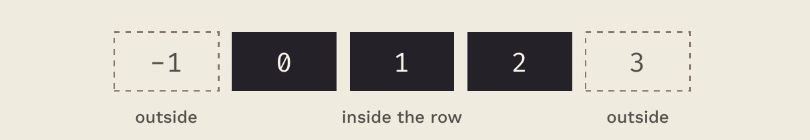
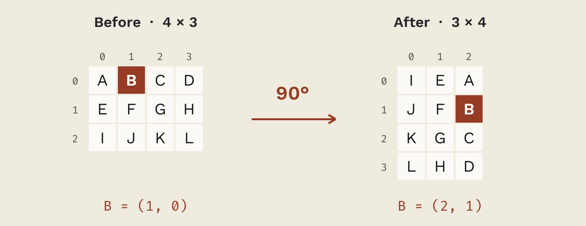
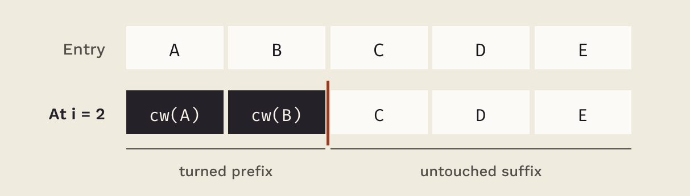
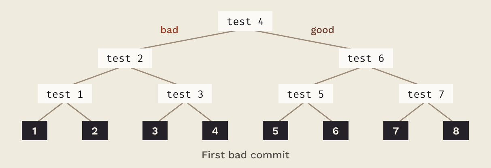

# The Software Engineer’s Introduction to Formal Verification

*With Lean, Rocq, and Dafny · Expanded edition · Pud.dev*

Rotate a photograph clockwise through 90 degrees. The pixel at the bottom left should appear at the top left. A test can tell you whether the right byte arrived. What would convince you the same code works for a one-pixel image, a long thin strip, and every other size the API accepts?

We’ll draw the turn and prove its address calculation on paper. Then we’ll see how [three proof runners](#proof-runners) check the same claim. A pencil is enough for the first four chapters. Later we’ll replace the turn with a reflection. Four checks will still pass. Their statements tell us why.

## Contents

1. [How to read a claim](#chapter-01)
2. [Draw the specification](#chapter-02)
3. [A proof on paper](#chapter-03)
4. [What counts as verification?](#chapter-04)
5. [Lean](#chapter-05)
6. [Rocq](#chapter-06)
7. [Dafny](#chapter-07)
8. [When a proof fails](#chapter-08)
9. [From a function to a system](#chapter-09)
10. [Read a page of mathematics](#chapter-10)
11. [The workbench](#chapter-11)
12. [Glossary and desk reference](#chapter-12)

    [A](#terms-a) · [B](#terms-b) · [C](#terms-c) · [D](#terms-d) · [E](#terms-e) · [F](#terms-f) · [G](#terms-g) · [H](#terms-h) · [I](#terms-i) · [K](#terms-k) · [L](#terms-l) · [M](#terms-m) · [N](#terms-n) · [O](#terms-o) · [P](#terms-p) · [Q](#terms-q) · [R](#terms-r) · [S](#terms-s) · [T](#terms-t) · [U](#terms-u) · [V](#terms-v) · [W](#terms-w) · [Symbols](#symbols) · [Companions](#companions)

<a id="chapter-01"></a>

## 1. How to read a claim

### Three boxes

Draw three boxes in a row and number them 0, 1, 2. The valid indices form the **set** $X=\{0,1,2\}$. A set records which values belong. Their order inside the braces makes no difference.



Read $2\in X$ as “2 belongs to X.” That sentence is true. “3 belongs to X” is false. Both are **propositions**, statements that can be true or false.

Give the row a width $w$ and call the proposed index $x$. Both are **integers**. They are whole numbers, including zero and the negative whole numbers. The symbol for their set is $\mathbb{Z}$. You’ll also meet $\mathbb{N}$, the **natural numbers**, here starting at zero. The choice changes subtraction. In Lean and Rocq, subtracting one from zero gives $-1$ on integers and $0$ on naturals.

> $0\leq x\land x<w$

That’s the array bounds check. Say it aloud as “x is at least zero **and** strictly less than w.” The symbol $\land$ joins the conditions. A paper often writes the same thing more compactly as $0\leq x<w$. Give this expression a name, $\mathrm{InRow}(w,x)$, and you have a **predicate**. At width 3, the predicate is true for index 2 and false for index 3.

### Who chooses first?

“Some index lies in this row” asks for one example. For a row of width three, choose $x=1$ and check $0\leq 1<3$. That index is a **witness**. “Every index stays in range when the row is reversed” gives the choice of index to someone else. Your argument must still work if they pick the last box.

The symbols are $\exists$, “there exists,” and $\forall$, “for every.” When they occur together, read from left to right to see who chooses first.

> $\forall x\in\mathbb{Z},\ \exists y\in\mathbb{Z},\ y>x$

For every integer x, there is an integer y greater than x. You name x first. Whatever you pick, I can return $x+1$. The rule supplies a witness for each possible x.

Now reverse the choices. $\exists y\in\mathbb{Z},\ \forall x\in\mathbb{Z},\ y>x$ would give us an integer bigger than every integer. For **each proposed y**, choose $x=y$. The final requirement becomes $y>y$. A single test at $x=7$ leaves $y=8$ in the running. Choosing $x=y$ gives you a **counterexample** for every proposed $y$. [Quantifiers and equality](https://lean-lang.org/theorem_proving_in_lean4/Quantifiers-and-Equality/)

$P\to Q$ says “if P holds, then Q holds.” To refute it, find a case with P true and Q false. For an image decoder, “if the decoder accepts an index, the index is in range” rules out accepting index 3 in our three-box row. A decoder that rejects index 2 can still keep that promise. If it must accept every valid index as well, write $P\iff Q$, “P if and only if Q.” Each direction has its own possible failure.

### A slot for each worker

Two workers each have a queue with slots numbered 0 and 1. A monitor takes a snapshot. At that instant, does each worker have a free slot? Is there one slot number free for both workers? Decide from the table before reading the formulas.

| Worker | Slot 0 | Slot 1 |
| --- | --- | --- |
| A | Free | Busy |
| B | Busy | Free |

Let $r$ range over these two workers and $s$ over these two slot numbers. Read $\mathrm{Free}(r,s)$ as “slot $s$ is free in worker $r$’s queue.”

> $\forall r,\ \exists s,\ \mathrm{Free}(r,s)$

“For each worker, I can name a free slot in its queue.” Put your finger on a row first. In A’s row choose 0. In B’s row choose 1. The row determines which answer you give.

> $\exists s,\ \forall r,\ \mathrm{Free}(r,s)$

“I can name a slot number that is free in every worker’s queue.” You have to put your finger on a column first and leave it there. “Choose 0 for A and 1 for B” answers the previous question. Here 0 fails at B and 1 fails at A. That disposes of every possible choice.

Suppose B finishes the job in slot 0. Which promise changes truth value? The first was already true. The second becomes true with the single witness 0. A column free for everyone supplies a free slot to each worker. The original table shows why the converse can fail.

<a id="chapter-02"></a>

## 2. Draw the specification

### Follow the B

Our image is a **raster**, a rectangle of pixels. Give each pixel one byte. Use the character codes for A through L, so A stands for 65, B for 66, and so on. The first row reads ABCD, the next EFGH, the last IJKL. An address is an ordered pair $(x,y)$. Columns count to the right, rows down from the top left, both from zero. B is at $(1,0)$. Sketch the three rows and turn the paper clockwise. Predict B’s new address before reading the right half of the figure.



After the turn, read the rows again. They are IEA, JFB, KGC and LHD. The old top row has become the rightmost column. Rows 0, 1 and 2 have become columns 2, 1 and 0. To reverse a row index, subtract it from the last one, $h-1$. Along each old row, the pixels now run from top to bottom, so the old column gives the new row.

> $\mathrm{cw}(h,(x,y))=(h-1-y,x)$

Use the **height before the turn** for $h$. On this image it is 3. The rightmost column after the turn is therefore 2.

### From pixels to TypeScript

A TypeScript `Point` has two `bigint` coordinates. The `n` suffix on `1n` makes it an integer of that type.

```typescript
export type Point = Readonly<{ x: bigint; y: bigint }>;

// h always means the height before the clockwise turn.
export function cw(h: bigint, p: Point): Point {
  return { x: h - 1n - p.y, y: p.x };
}
```

For an independent check, give the twelve labelled bytes to the Pillow image library. Its coordinates also start at the top left. Its `Transpose.ROTATE_270` operation produces IEA, JFB, KGC, LHD. The name makes sense once you know that Pillow counts positive angles counterclockwise. [TypeScript examples](examples.ts) · [Pillow coordinates](https://pillow.readthedocs.io/en/stable/handbook/concepts.html#coordinate-system) · [Pillow image operations](https://pillow.readthedocs.io/en/stable/handbook/tutorial.html#geometrical-transforms)

A **specification** says what counts as correct behaviour. Start with the address. A point is *inside* when each coordinate passes its own bounds check.

> $\mathrm{Inside}(w,h,(x,y))\iff (0\leq x<w)\land(0\leq y<h)$

This is the Boolean version used by the TypeScript examples.

```typescript
export function inside(w: bigint, h: bigint, p: Point): boolean {
  return 0n <= p.x && p.x < w && 0n <= p.y && p.y < h;
}
```

### Two promises about one picture

Read this statement with integer dimensions $w$ and $h$, and a pair of integer coordinates $p$.

> $\forall w,h,p,\ \mathrm{Inside}(w,h,p)\to\mathrm{Inside}(h,w,\mathrm{cw}(h,p))$

Say it aloud. “For any width, height and point, if the point fits the old image, its turn fits the new one.” On the right of the arrow, width and height have exchanged places. For B the conclusion is $\mathrm{Inside}(3,4,(2,1))$. At width zero, the premise is false for every point. An API that accepts or rejects empty rasters needs to make that choice separately.

What would happen if `cw` simply returned $(0,0)$? Any image containing a legal pixel has positive width and height. Its turned image therefore contains $(0,0)$ too. Every source pixel could land in that one spot and the bounds theorem would still hold. We’ll add the ability to recover the original address in chapter 3.

A caller handing over actual pixels also expects their **values** to travel. Let `input[row][column]` mean the byte at that row and column, and keep the input intact while constructing the output. For every valid source address the required value is

> $\mathrm{output}[x][h-1-y]=\mathrm{input}[y][x]$.

For B that means $\mathrm{output}[1][2]=\mathrm{input}[0][1]$. The address is written column first, $(2,1)$. The array lookup starts with row 1. Suppose the copier computes every destination correctly, then writes a zero byte at each one. B’s slot would be in bounds and contain zero.

<a id="chapter-03"></a>

## 3. A proof on paper

### Four bounds

Let the caller choose a width, a height and any legal address $(x,y)$. Resist the temptation to draw B again. At B the old row happened to be zero. The caller never promised that. Expanding `Inside` gives precisely the four facts we can count on.

> $0\leq x,\qquad x<w,\qquad 0\leq y,\qquad y<h$

The new address is $(h-1-y,x)$ and its raster is h columns wide by w rows high. Write down the four bounds that must hold there.

| Required bound | Reason |
| --- | --- |
| $0\leq h-1-y$ | Since $y<h$ and both are integers, $y\leq h-1$. Subtract y from both sides. |
| `h - 1 - y < h` | Subtracting a nonnegative y from $h-1$ gives at most $h-1$, already below h. |
| $0\leq x$ | This is the old lower bound on x. |
| $x<w$ | This is the old upper bound on x. |

The first deduction depends on the gap between consecutive integers. Try to use the same argument for fractional coordinates. With $h=3$ and $y=2.5$ the old bounds admit y, but the new x is $-0.5$. There is room for 2.5 between 2 and 3. There is no integer there.

These are all steps in **linear arithmetic**. Sums, differences and multiplication by fixed integer constants stay within it. Multiplying two unknowns, such as $w\times h$, takes you outside it. That distinction is why an arithmetic tactic in chapter 5 can settle these bounds automatically.

We’ll reuse this result. A proved statement is a **theorem**. When it serves as a step towards another result, writers often call it a **lemma**. To use the bounds lemma, a caller need only establish that the incoming point is legal.

### Recover the old address

The rotated B sits at $(2,1)$. Its new row, 1, tells us the old column. Its distance from the new right edge, zero, tells us the old row. The same reasoning gives the inverse for any turned address $(u,v)$. The width after the turn is the height we called h before it.

> $\mathrm{ccw}(h,(u,v))=(v,h-1-u)$

```typescript
export function ccw(h: bigint, p: Point): Point {
  return { x: p.y, y: h - 1n - p.x };
}
```

Apply the functions in succession. Parentheses tell you which call to make first.

$$
\begin{aligned}
p &= (x,y) \\
\mathrm{cw}(h,p) &= (h-1-y,x) \\
\mathrm{ccw}(h,\mathrm{cw}(h,p)) &= (x,h-1-(h-1-y)) \\
&= (x,y)
\end{aligned}
$$

For the last step, call $h-1$ by the shorter name m. Then $m-(m-y)=m-m+y=y$. The old x travelled through the second field and back into the first. Equality of both coordinates gives equality of the two ordered pairs.

Look for a step in the cancellation that needs $0\leq y<h$. There isn’t one. The two calls return $(-40,600)$ to $(-40,600)$ just as they restore B. An editor holding an off-canvas point can therefore use the undo theorem. It would first need a legal point to use the bounds theorem.

<a id="chapter-04"></a>

## 4. What counts as verification?

### One raster and every raster

**Formal verification** uses mathematical reasoning to establish that a precisely described system satisfies a stated property. A machine-checked proof records enough detail for a program to check the deductions. In our bounds proof you can see how finitely many steps cover infinitely many inputs. The deduction from $y<h$ to $y\leq h-1$ works however large h is.

The twelve-letter image answers a different question. Feed it to an image library and compare the output with IEA, JFB, KGC, LHD. A passing test checks the pixels, the order of the bytes and the dimensions together for that case. A **property-based test** can generate many rectangles and check the byte equation at each valid address. A **differential test** can run two implementations, such as the TypeScript pixel copy and Pillow, on the same input and compare their results. If the two results disagree, save that rectangle. It is enough to reproduce the difference. Agreement tells you about the rectangles you ran.

A **model checker** takes initial states, rules for the possible next steps and a property to check. For a finite configuration an explicit-state checker such as TLC can explore every reachable state. If a state breaks a safety rule, the path to it explains how the system got there. Chapter 9 has a two-account example where the order of a reader’s and a writer’s steps matters. [Lamport on the TLA+ tools](https://lamport.azurewebsites.net/tla/tools.html)

### What is a proof runner?

<a id="proof-runners"></a>

A **proof runner** is the tool you call to check a claim in a file. In chapter 3 we claimed that turning a point and undoing the turn gives you the original point back. Run `lean proofs/Turn.lean` from the book directory. Lean reads the two functions and checks the proof of that claim. You never have to pick a height or a point.

Lean and Rocq are **proof assistants**. In both, you can write instructions called *tactics* to build a proof. Each assistant has a small checker, its *kernel*, that reads the finished proof and checks that each deduction is allowed. Dafny is a **program verifier**. You put a promise beside the code. Dafny works out what must be true for the code to keep that promise and sends those questions to Z3, a program that reasons about equations and other rules.

| Tool | How the file proves that undo works |
| --- | --- |
| Lean | Name the original coordinates $x$ and $y$. Ask the arithmetic tactic `omega` to prove $h-1-(h-1-y)=y$. Use that equality to recover $(x,y)$. |
| Rocq | Replace the same long expression with $y$, using the arithmetic tactic `lia` to justify the replacement. Both sides now read $(x,y)$. The command `reflexivity` finishes the proof. |
| Dafny | Write the promise after `ensures` and leave the proof body empty. Z3 can settle this equality from the two function definitions alone. |

Suppose you change undo to always return $(0,0)$. Start at $(1,0)$ and you can see why the claim fails. A run can also stop because you left out a step that the checker needs, even when the claim is true.

Chapter 5 uses Lean to return a pixel address with proof that it fits the image. Chapter 6 uses Rocq to show that turning and undoing a list restores every point in order. In chapter 7, Dafny checks a loop that overwrites the points in an array. You can [run all three companions](#companions).

### The first odd width

A row reversal should send index $x$ to $w-1-x$. Someone implements it by first finding half the width. For positive `bigint` values, division by `2n` discards any remainder.

```typescript
function mirrorViaHalf(w: bigint, x: bigint): bigint {
  const half = w / 2n;
  return 2n * half - 1n - x;
}
```

At width two the answers are 1, 0. At width four they are 3, 2, 1, 0. That exercises every legal index in both rows. Predict the answer at the **last** index of a row of width three. Then run the calculation by hand.

The expected answer is 0. The code halves 3 to get 1, doubles 1 to get 2, then subtracts 1 and the index 2. It returns $-1$. The two passing rows hid an assumption. Doubling the integer half restores an even width. For an odd width $w=2m+1$, it restores $2m$ and loses one column.

Return to the intended formula. Take any integers with $0\leq x<w$. Since $x\leq w-1$, the result $w-1-x$ is at least zero. Since $x\geq0$, the result is at most $w-1$. Both deductions work for odd widths too.

Take width 1,000,001 and index 741,002. You can check that the result lies in range before you calculate 258,998. Check the premise, then reuse the two inequalities above. The proof never needed a list of widths to try. To use it for the function above, we would also have to show that the code computes $w-1-x$. The width-three call is enough to refute that claim.

### What the caller can assume

A sampler returns an address and guarantees it fits the image. A pixel reader requires a valid address before it can look up a byte. Put the routines together. The sampler’s **postcondition**, what it guarantees on return, supplies the reader’s **precondition**, what it requires on entry.

This idea appears in papers as a **Hoare triple**, $\{P\}\ C\ \{Q\}$. Start command $C$ with $P$ true. If $C$ terminates normally, $Q$ must hold afterwards. That’s *partial correctness*. A routine that spins forever satisfies this particular contract. Its caller still has a request hanging. *Total correctness* requires the routine to finish as well. For the rotation loop, we’ll prove that by counting the slots left to process. [Hoare logic in Software Foundations](https://softwarefoundations.cis.upenn.edu/plf-current/Hoare.html)

A contract also chooses its arithmetic. The coordinate model uses exact signed integers, represented in TypeScript by `bigint`. A caller taking coordinates as JavaScript `number` values has additional work. Fractions, infinities and `NaN` can all cross that interface. For the byte buffer, the companion validates positive, safe-integer dimensions and checks them against the buffer’s length. A type assertion alone would perform none of those checks.

### A midpoint that turns negative

In 2006 Joshua Bloch described a midpoint overflow in the JDK’s binary search. A binary search keeps two inclusive indices, lo and hi, and probes their midpoint. On paper their average lies between them. The Java implementation added the indices as signed 32-bit `int` values before dividing by two. Such an integer ranges from $-2^{31}$ through $2^{31}-1$. [Joshua Bloch’s account](https://research.google/blog/extra-extra-read-all-about-it-nearly-all-binary-searches-and-mergesorts-are-broken/) · [Java integer addition](https://docs.oracle.com/javase/specs/jls/se21/html/jls-15.html#jls-15.18.2)

To reproduce Java’s addition in TypeScript, we have to ask for the overflow. Ordinary JavaScript `number` represents these particular sums exactly. The explicit `| 0` keeps the low 32 bits and interprets them as signed. `Math.trunc` reproduces Java integer division toward zero.

```typescript
export function brokenMidpoint32(lo: number, hi: number): number {
  const sum = (lo + hi) | 0;
  return Math.trunc(sum / 2);
}
```

Give the array indices 0 through $2^{30}$, store i at index i, and search for $2^{30}$. Eventually the two inclusive indices are $2^{30}-1$ and $2^{30}$. Their sum still fits. The probe chooses the lower one and the search advances lo. Now $\mathrm{lo}=\mathrm{hi}=2^{30}$. Their mathematical sum is $2^{31}$, which wraps to $-2^{31}$. The resulting midpoint is $-2^{30}$. The failing search needs over a billion entries. Reproducing its midpoint needs two numbers.

```typescript
export function midpoint(lo: number, hi: number): number {
  return lo + Math.floor((hi - lo) / 2);
}
```

Why does the replacement work? Assume integer indices with $0\leq\mathrm{lo}\leq\mathrm{hi}\leq 2^{31}-1$. The difference $\mathrm{hi}-\mathrm{lo}$ is between zero and the largest signed integer. Taking half, rounded down, stays between zero and that difference. Add lo and the result lies between lo and hi, so the addition also fits. Since the difference is nonnegative, rounding down has the same effect as Java’s truncation toward zero. Both intermediate results fit the original machine type. We’ll reuse this midpoint when we count Git probes. [Executable midpoint examples](examples.ts)

<a id="chapter-05"></a>

## 5. Lean

### A point and a proof about it

Lean lets you put a function and its proof in one language. The point below has two fields of type `Int`, Lean’s arbitrary-precision signed integer. A colon gives a type, and `:=` introduces a definition’s body. Function calls use spaces. Read `cw h p` as `cw(h, p)`. [Lean companion](proofs/Turn.lean)

```lean
structure Pt where
  x : Int
  y : Int
  deriving Repr, DecidableEq

def Inside (w h : Int) (p : Pt) : Prop :=
  (0 ≤ p.x ∧ p.x < w) ∧ (0 ≤ p.y ∧ p.y < h)

def cw (h : Int) (p : Pt) : Pt :=
  ⟨h - 1 - p.y, p.x⟩
```

The angle brackets construct the expected record from its fields in order. `deriving` asks Lean for code to display a point and decide whether two concrete points are equal. The single example below proves where B goes. `rfl` works because both sides compute to the same point. If you expect `⟨1, 2⟩` on the right, they cease to agree.

```lean
example : cw 3 ⟨1, 0⟩ = ⟨2, 1⟩ := rfl
```

Read the three declarations from the colon outwards. In `p : Pt`, `p` names a point. In `Inside w h p : Prop`, the expression on the left is a claim about the point. Finally, `hp : Inside w h p` names evidence that the claim is true. The proposition itself gives the **type of its proof**. A proof of $P\to Q$ is a function that takes evidence for P and returns evidence for Q. This correspondence is called *propositions as types*. [Propositions and proofs](https://lean-lang.org/theorem_proving_in_lean4/Propositions-and-Proofs/)

### Inside the goal window

```lean
theorem cw_inside {w h : Int} {p : Pt}
    (hp : Inside w h p) : Inside h w (cw h p) := by
  rcases hp with ⟨⟨hx0, hxw⟩, ⟨hy0, hyh⟩⟩
  change (0 ≤ h - 1 - p.y ∧ h - 1 - p.y < h) ∧
         (0 ≤ p.x ∧ p.x < w)
  constructor
  · constructor <;> omega
  · exact ⟨hx0, hxw⟩
```

Read the first two lines as a signature. The width, height and point in braces can usually be inferred. Supply evidence `hp` for the old bounds and the theorem produces evidence for the new ones. After `by` come **tactics**, commands that construct a proof term. Lean’s **kernel** checks the resulting term. [Lean tactics](https://lean-lang.org/theorem_proving_in_lean4/Tactics/) · [Lean’s kernel](https://lean-lang.org/doc/reference/latest/Elaboration-and-Compilation/)

`rcases` unpacks the input into four named inequalities. `change` spells out the result in coordinates. Lean checks that unfolding the definitions actually gives the proposed expression. The first `constructor` splits the outer “and” into one goal per coordinate.

The first bullet splits the x inequalities and sends both to `omega`, an arithmetic tactic for integers and naturals. The punctuation `<;>` applies the tactic on its right to each goal created on its left. Just before the last line, the relevant facts and the outstanding goal look like this.

```lean-goal
hx0 : 0 ≤ p.x
hxw : p.x < w
⊢ 0 ≤ p.x ∧ p.x < w
```

The turnstile `⊢` means “show this.” The goal asks for the pair of facts already sitting above it. `exact ⟨hx0, hxw⟩` supplies them. These are the last two rows of the paper proof, where the old x became the new y.

### Which hypothesis would you use?

Go back one branch in `cw_inside`. The compact line `constructor <;> omega` proves two inequalities. If you split them and pause before the first `omega`, Lean shows this context and goal.

```lean-goal
w h : Int
p : Pt
hx0 : 0 ≤ p.x
hxw : p.x < w
hy0 : 0 ≤ p.y
hyh : p.y < h
⊢ 0 ≤ h - 1 - p.y
```

Start at `⊢` and read the last line aloud as “the new column is at least zero.” Now look up. Which of the four named facts would let you establish it? Try saying the argument in one sentence before you choose a tactic.

`exact hy0` is a tempting answer. Both inequalities start with `0 ≤`. But `hy0` puts that lower bound on `p.y`. Set $h=3$ and $p.y=3$. The fact `hy0` holds, yet the proposed column is $-1$. This is a counterexample to using that fact alone. The full context rules it out with `hyh`.

Use `hyh`. The old row is an integer strictly below $h$, so it is at most $h-1$. Subtracting the old row from $h-1$ leaves a nonnegative integer. You just performed the deduction that `omega` can do for Lean. The command `exact` needs a proof of the goal already in hand.

Try the sibling goal, `h - 1 - p.y < h`. Which old bound is enough? This time `hy0` suffices. Subtract a nonnegative row from $h-1$ and the result stays below $h$. A row of $-1$ shows why losing that lower bound matters. It gives new column $h$, exactly the first column outside the edge.

### Carry the bounds with the point

```lean
structure Cell (w h : Int) where
  point : Pt
  valid : Inside w h point

def rotateCell {w h : Int} (c : Cell w h) : Cell h w :=
  ⟨cw h c.point, cw_inside c.valid⟩
```

The first field is an address. The second is evidence that *this address* fits dimensions w and h. This is a **dependent type**. Values such as w and h can appear in the type itself. `Cell 4 3` permits $(3,2)$. Try to use x equal to 4 and the required evidence would include $4<4$.

Two unrelated four-by-three images accept exactly the same `Cell 4 3`. The dimensions determine which coordinates fit. To identify which image supplied a byte, you’d need to represent the image or its identity as well. The type here carries dimensions and an address.

In `rotateCell` the new coordinates come from `cw`, and the previous theorem produces the evidence needed to construct a `Cell h w`. A TypeScript brand can communicate that a constructor checked the bounds. Lean can also check the construction of the evidence each caller passes along. When Lean compiles the program it erases fields holding proofs in `Prop`. An image decoder still has to establish its input bounds at the point where outside data enters. [Dependent types](https://lean-lang.org/theorem_proving_in_lean4/Dependent-Type-Theory/) · [Propositions in compiled code](https://lean-lang.org/doc/reference/latest/The-Type-System/Propositions/)

### Can two addresses collide?

Suppose two source addresses have the same destination. Apply undo to that one destination. Can it return two different sources? The whole argument fits into two tactic lines.

```lean
theorem no_merge (h : Int) (p q : Pt)
    (same : cw h p = cw h q) : p = q := by
  have back := congrArg (ccw h) same
  simpa only [undo_cw] using back
```

A function with this property is **injective**. The hypothesis `same` says the two destinations are equal. `congrArg` applies a function to both sides of an equality. With `ccw h` as that function, `back` is evidence for

> `ccw h (cw h p) = ccw h (cw h q)`.

The companion proves `undo_cw` by the cancellation from chapter 3. Simplify each side using that lemma and what remains is `p = q`. That’s the job of `simpa only [undo_cw] using back`. Nothing in those two tactic lines inspects a coordinate. Any function with a left inverse admits the same proof.

To see the assumptions under it, ask Lean for `#print axioms no_merge`. An **axiom** is a statement the system accepts as a starting point. This proof reports `propext` and `Quot.sound`, principles about equivalence of propositions and quotient types used by its dependencies. A declaration filled with the placeholder `sorry` would make its dependants report `sorryAx`. [Axioms and computation](https://lean-lang.org/theorem_proving_in_lean4/Axioms-and-Computation/)

<a id="chapter-06"></a>

## 6. Rocq

### The type of an equality

An image-processing pipeline can carry a trace of sampled addresses alongside an image. A trace can visit A, then B, then A again. Rotating the trace and undoing the rotation ought to recover both visits to A, in their original positions. We’ll prove this in Rocq, formerly Coq. Its language for definitions and terms is called **Gallina**. [Rocq companion](proofs/Turn.v) · [The Rocq Prover](https://rocq-prover.org/)

```coq
From Stdlib Require Import ZArith Lia List.
Import ListNotations.
Open Scope Z_scope.

Record Pt := pt { px : Z; py : Z }.

Definition inside (w h : Z) (p : Pt) : Prop :=
  (0 <= px p < w) /\ (0 <= py p < h).

Definition cw (h : Z) (p : Pt) : Pt :=
  pt (h - 1 - py p) (px p).

Definition ccw (h : Z) (q : Pt) : Pt :=
  pt (py q) (h - 1 - px q).

Example turn_one : cw 3 (pt 1 0) = pt 2 1.
Proof. reflexivity. Qed.
```

`Z` is the type of signed integers, and `Open Scope Z_scope` gives the arithmetic symbols that interpretation. The constructor `pt` builds a point. The field readers `px` and `py` retrieve its coordinates. `/\` means “and.” Each command ends with a period.

In an editor, enter `Check (cw 3 (pt 1 0) = pt 2 1).` The answer is `Prop`. Now enter `Check turn_one.` The answer is the equality itself, `cw 3 (pt 1 0) = pt 2 1`. The first command inspected a proposition. The second inspected the proof named by `Example`. Between `Proof.` and `Qed.`, `reflexivity.` establishes that both expressions compute to the same point. [Proof objects in Software Foundations](https://softwarefoundations.cis.upenn.edu/lf-current/ProofObjects.html)

### Reading the tactics

```coq
Theorem cw_inside : forall w h p,
  inside w h p -> inside h w (cw h p).
Proof.
  intros w h [x y] [[Hx0 Hxw] [Hy0 Hyh]].
  cbn [px py] in Hx0, Hxw, Hy0, Hyh.
  change ((0 <= h - 1 - y < h) /\ (0 <= x < w)).
  split.
  - split; lia.
  - exact (conj Hx0 Hxw).
Qed.
```

Read the theorem above the word `Proof` first. `forall` introduces an arbitrary width, height and point. The arrow adds an assumption about that point. `intros` brings the inputs and the assumption into the proof. The pattern `[x y]` opens the point record. The nested brackets give names to the four bounds.

`cbn [px py]` reduces field reads, so `Hxw` now says $x<w$. `change` spells out the destination bounds. `split` creates one goal for each coordinate. In the first branch, `split; lia.` separates the two inequalities and asks `lia` to settle each by linear integer arithmetic. In the second branch, `conj Hx0 Hxw` constructs a conjunction from the two old x bounds.

Rocq checks the proof term built by these tactics. Ask for `Print Assumptions cw_inside.` This companion reports “Closed under the global context.” Closing an unfinished declaration with `Admitted.` would instead introduce an assumption that follows it into any dependent proof. [Rocq proof commands](https://rocq-prover.org/doc/V9.3.0/refman/proof-engine/vernacular-commands.html)

### From one sample to a trace

A set containing A and B forgets the second visit to A. A list preserves each visit. There are only two ways to construct a list in Rocq. Start with the empty list `[]`, or put an element `p` in front of another list `tail` to form `p :: tail`. A function over lists can give a rule for each shape.

```coq
Fixpoint turnAll (h : Z) (ps : list Pt) : list Pt :=
  match ps with
  | [] => []
  | p :: tail => cw h p :: turnAll h tail
  end.
```

`Fixpoint` introduces a recursive definition. The second rule turns the first point, then applies the same function to the tail. Rocq can see that the tail is a smaller part of the original list, so the recursion terminates. For `[A, B, A]` the calls receive `[A, B, A]`, `[B, A]`, `[A]`, then `[]`.

The library function `map f` applies a function f to every element in order. On the trace `[A, B, A]`, turning and then mapping undo must recover A twice, with B between the visits. Equality of lists says all of that in one statement.

```coq
Theorem undo_all : forall h ps,
  map (ccw h) (turnAll h ps) = ps.
Proof.
  intros h ps.
  induction ps as [| p tail IH].
  - reflexivity.
  - cbn [turnAll map].
    rewrite undo_cw, IH.
    reflexivity.
Qed.
```

### Why induction works

Start with an empty trace. Turning it and mapping undo over it both return `[]`. That proves the **base case**, discharged by the first `reflexivity`.

Now suppose you can restore the tail of a trace. Prepend one more point p. What new work is there? Undo the turn of p, and use what you know about the tail. The command `induction` provides exactly that smaller result as the **induction hypothesis**, here named `IH`. After `cbn` expands one layer of each function, the remaining equality reads

```rocq-goal
ccw h (cw h p) :: map (ccw h) (turnAll h tail)
= p :: tail
```

Cover the expression before `::` on each side. What would make the tails equal? The type of `IH` is precisely `map (ccw h) (turnAll h tail) = tail`. Now uncover the heads. The separate lemma `undo_cw` equates those two points. `rewrite undo_cw, IH` uses each equality once, and the final `reflexivity` closes the proof.

It can feel circular to assume that undo works on a list while proving that undo works on lists. Try building the proof for `[A, B]` from the end. The base case settles `[]`. One use of the step settles `[B]`. The next settles `[A, B]`. A list of length $n$ takes $n$ uses of the same step. Every finite list can be built that way. [Induction in Software Foundations](https://softwarefoundations.cis.upenn.edu/lf-current/Induction.html)

If a program needs the executable definition, Rocq can extract functions such as `turnAll` to OCaml. An application calling that code also relies on the extraction and target compilation steps. A handwritten TypeScript implementation would need its own connection to the checked definition. [Rocq extraction](https://rocq-prover.org/doc/V9.3.0/refman/addendum/extraction.html)

<a id="chapter-07"></a>

## 7. Dafny

### A lemma with an empty body

Suppose the sampler keeps its trace in a mutable array. We want to replace the address stored in each slot with its turned address. Two entries may name the same pixel. Each entry will stay in its original slot. The raster bytes live in a separate buffer.

Dafny can describe pure functions and mutable methods in the same file. Its `int` denotes a mathematical integer. Here are the point definition, the bounds predicate and the forward turn. [Dafny companion](proofs/Turn.dfy)

```dafny
datatype Pt = Pt(x: int, y: int)

predicate Inside(w: int, h: int, p: Pt)
{
  0 <= p.x < w && 0 <= p.y < h
}

function Cw(h: int, p: Pt): Pt
{
  Pt(h - 1 - p.y, p.x)
}
```

```dafny
lemma CwInside(w: int, h: int, p: Pt)
  requires Inside(w, h, p)
  ensures Inside(h, w, Cw(h, p))
{
}
```

The last pair of braces is empty. Expanding `Cw` and `Inside` leaves the four integer inequalities we proved on paper. Dafny can discharge them without another hint. Whoever uses the lemma must supply its `requires` clause. They may then rely on its `ensures` clause. A second lemma in the file, `UndoCw`, establishes the round trip on all signed points.

### Could the new x reach the edge?

Dafny translates proof obligations through Boogie and gives them to Z3, an **SMT solver**. SMT stands for *satisfiability modulo theories*. The theories give meaning to operations on integers, records and other values. The solver can ask whether some assignment of values makes a collection of conditions true all at once. An explicit `assume` would add a premise without proving it. [Dafny verification guide](https://dafny.org/v4.11.0/VerificationOptimization/VerificationOptimization) · [Dafny reference](https://dafny.org/v4.11.0/DafnyRef/DafnyRef)

One **verification condition** asks whether the upper x bound follows from the input bounds. To see the solver’s job, imagine trying to refute that implication. Keep the premises and add the negation of the desired conclusion.

> $0\leq x<w,\qquad 0\leq y<h,\qquad h-1-y\geq h$

Subtract h from the last line. It becomes $-1-y\geq 0$, which gives $y\leq -1$. The second line gives $y\geq 0$. No integer satisfies both. The conditions are **unsatisfiable**, so there is no assignment that breaks this bound. Dafny may send several such obligations to the solver in one query.

If the last line instead read $h-y\geq h$, a one-pixel image would supply a witness. Its point $(0,0)$ would produce new x equal to 1 at height 1. This is the off-by-one bug we’ll try in chapter 8.

A solver may also time out. A timeout alone leaves the mathematical question open. An intermediate `assert` asks the solver to establish a smaller fact it can then use. A named lemma lets other proofs use the fact too. Linear integer arithmetic has a decision procedure. Some questions about arbitrary programs, including whether an arbitrary program on a given input ever halts, admit no procedure that always terminates with the correct yes or no. [Verification optimisation](https://dafny.org/v4.11.0/VerificationOptimization/VerificationOptimization) · [MIT on computability](https://ocw.mit.edu/courses/6-006-introduction-to-algorithms-fall-2011/a2ee5c645c0c690e76f5d0db4807edcd_moPtwq_cVH8.pdf)

### The array before and after a call

```dafny
method TurnInPlace(h: int, a: array<Pt>)
  modifies a
  ensures forall k :: 0 <= k < a.Length ==>
    a[k] == Cw(h, old(a[k]))
```

`modifies a` is a **frame** clause. It permits writes to the array object a. If a caller holds a second reference to that object, it sees the writes through that reference too. Other objects that existed on entry are outside this permission.

In the postcondition, `old(a[k])` reads slot k as it stood on entry. The unqualified `a[k]` reads it on return. For every valid k, those two values must be related by `Cw`. The method works even on repeated or out-of-bounds sample coordinates because its contract promises this arithmetic relation for each entry. Bounds on a particular trace can be established by a caller using `CwInside`.



In the diagram A through E stand for *addresses stored in trace slots*. The vertical line separates the finished prefix from the unread suffix. Pause at any loop guard and you should be able to say what is in each region. A claim true at every such visit is a **loop invariant**.

### One more finished slot

```dafny
{
  ghost var before := a[..];
  var i := 0;
  while i < a.Length
    invariant 0 <= i <= a.Length
    invariant forall k :: 0 <= k < i ==>
      a[k] == Cw(h, before[k])
    invariant forall k :: i <= k < a.Length ==>
      a[k] == before[k]
    decreases a.Length - i
  {
    a[i] := Cw(h, a[i]);
    i := i + 1;
  }
}
```

`before` is a **ghost** variable. It holds an immutable sequence of the entry values, for use in the proof. Dafny erases it from the executable. At the guard, `i` counts how many slots are finished.

**Entry.** At `i = 0` the empty prefix satisfies its rule and the entire array agrees with the fresh snapshot. Zero also lies between zero and the array length, even for an empty trace.

**Exit.** If the three invariants still hold when the guard is false, we have `i ≥ a.Length` and `i ≤ a.Length`. Hence i equals the length and the prefix rule covers every slot. This gives the postcondition.

For termination, count the remaining slots. `a.Length - i` is positive whenever the body runs and falls by one per iteration. A nonnegative integer cannot fall forever. The `decreases` clause asks Dafny to check that part of total correctness. Now freeze the loop just after a write. Which facts survive the assignment? [Dafny on loops and termination](https://dafny.org/v4.11.0/OnlineTutorial/guide)

### Between the two assignments

Take height three and an array of three sample addresses. At `i = 1` the first slot is finished. The loop writes `a[1] := Cw(h, a[1])` and then increments `i`. Stop **between** those assignments. Is it still true that every slot from `i` onwards equals its entry value?

| Moment | `i` | `a[0]` | `a[1]` | `a[2]` |
| --- | --- | --- | --- | --- |
| Entry | 0 | $(0,0)$ | $(1,0)$ | $(3,2)$ |
| Before the write | 1 | $(2,0)$ | $(1,0)$ | $(3,2)$ |
| After the write | 1 | $(2,0)$ | $(2,1)$ | $(3,2)$ |
| Next guard | 2 | $(2,0)$ | $(2,1)$ | $(3,2)$ |

In the “After the write” row, slot 1 belongs to the old suffix by its index, but already contains its turned address. The suffix assertion is false at this instant. Dafny checks that the body re-establishes it for the next guard. Moving `i` to 2 puts that slot on the finished side.

Call the old index $j$ and the array length $n$. To prove the two array claims for **every** slot, let the caller pick a valid $k$. Its position relative to $j$ determines which fact survives.

**Left of the write** ($k<j$). The old prefix rule already gave the turned value for this slot. Writing slot $j$ leaves it alone.

**At the write** ($k=j$). The old suffix rule says the value about to be read is `before[j]`. The assignment therefore stores `Cw(h, before[j])`. This is the one new member of the finished prefix.

**Right of the write** ($k>j$). The old suffix rule gave the entry value. This slot receives no write, so the new suffix still agrees with the snapshot.

Those cases cover every integer index. The old guard gives $j<n$, hence $j+1\leq n$, and the old index bound gives $0\leq j+1$. With `i` now equal to $j+1$, all three invariants hold at the same program point again.

<a id="chapter-08"></a>

## 8. When a proof fails

### A bad program or a missing fact?

In a copy of a companion file, remove the `- 1` from the forward turn. Keep the inverse and the desired results as written. Here is what the checkers encounter.

| Tool | First clues |
| --- | --- |
| Lean | `rfl` fails for B. The hand-expanded bounds in `change` also disagree with the new definition. |
| Rocq | The compiler stops at `turn_one`. The computed point differs from `pt 2 1`. |
| Dafny | The new x upper bound in `CwInside` fails, and so does the round trip in `UndoCw`. |

At $y=0$ the new x is h. The last legal column is $h-1$. Every top-row pixel supplies a failing call, including the only pixel in a one-by-one image. A regression test for this defect needs one pixel.

Restore the correct turn. This time remove only the *suffix invariant* from the Dafny loop. Consider a one-slot array at height 2. At `i = 0` imagine the snapshot contains `[(0, 0)]` while the current array contains `[(0, 1)]`. The index bound holds and the finished prefix is empty. Both surviving invariants admit the state.

The next write would turn the current $(0,1)$ into $(0,0)$. The postcondition asks for the turn of the original $(0,0)$, namely $(1,0)$. Try to reach that state from method entry. At index zero the snapshot has just been taken, and no assignment could have changed the slot. Dafny needs a fact that carries this agreement forward to whatever slot is next. The suffix invariant supplies it.

### A green check for a reflection

Here is a faulty rotation that passes all four checks in the base Dafny file. Change both turns to swap the coordinates. The map $(x,y)\mapsto (y,x)$ reflects addresses across the line $y=x$ and exchanges the raster’s dimensions. Every legal point still lands in range. Swapping twice restores the starting point. The loop faithfully applies the new function to each slot.

What distinguishes a clockwise turn? Look at B. A clockwise turn sends $(1,0)$ to $(2,1)$. A reflection sends it to $(0,1)$. Lean and Rocq already contain that labelled check. To describe the distinction for every point, use B’s distance from two edges. The old column becomes the new row. The distance from the new right edge equals the distance from the old top edge.

Writing $(x,y)$ for the old address and $(u,v)$ for the new one gives two equations.

> $v=x,\qquad (h-1)-u=y$

For a legal pixel the distances count steps to an edge. As algebra, the equations make sense for every integer point. A fixed input determines both output coordinates. Solving the second gives $u=h-1-y$. An implementation could use arithmetic or a lookup table. The equations give either one the same obligation. A separately written undo still needs the round-trip theorem. A correct forward turn could coexist with an undo that always returned the origin.

### Checking the direction in Dafny

The fourth companion file checks the orientation directly. Its `include` line brings in the functions from the original file.

```dafny
include "Turn.dfy"

lemma Clockwise(h: int, p: Pt)
  ensures Cw(h, p).y == p.x
  ensures (h - 1) - Cw(h, p).x == p.y
{
}
```

From the book directory, run `dafny verify proofs/Turn.dfy` and `dafny verify proofs/Orientation.dfy`. The first reports `4 verified, 0 errors`. The second reports `1 verified, 0 errors` for the new lemma. [Base proofs](proofs/Turn.dfy) · [Orientation lab](proofs/Orientation.dfy)

For the experiment, copy both files into one directory. In that copy make `Cw` return `Pt(p.y, p.x)` and make `Ccw` return `Pt(q.y, q.x)`. Verify each file again. The original four units pass. The orientation check fails on its **second** equation. B shows exactly why. The reflected point’s new x is zero, two columns from the right edge, whereas B started zero rows from the top. The first equation still holds. The failed equation points to the exact edge distance the reflection gets wrong.

### What has to be maintained?

| Change | Where the proof lives |
| --- | --- |
| An API must return a sample fitting the new dimensions. | Lean’s `rotateCell` packages the new address and its bounds for the next caller. |
| A trace changes representation. | Rocq’s structural proof follows the list constructors. A tree would require cases for its own constructors. |
| A method rewrites shared storage. | Dafny’s contract names the array it may change and describes each slot’s value relative to entry. Its loop records the facts needed between writes. |

Lean and Rocq both support dependent types, induction and proof automation. Dafny has recursive functions and inductive lemmas as well as mutable methods. A change from a list to a tree disturbs the structural proof. A new alias to the array raises a question about writes. Neither change alters the formula for a quarter turn.

The usual Lean and Rocq tactics build proof terms that a kernel checks under its theory’s assumptions. In a standard Dafny run the guarantee also depends on a faithful translation to verification conditions and correct answers from the solver. Shipping executable code can add a compiler, a foreign interface and a runtime to the chain of components you rely on. [Lean’s kernel](https://lean-lang.org/doc/reference/latest/Elaboration-and-Compilation/) · [Rocq extraction](https://rocq-prover.org/doc/V9.3.0/refman/addendum/extraction.html) · [Dafny’s verifier](https://dafny.org/v4.11.0/DafnyRef/DafnyRef)

<a id="chapter-09"></a>

## 9. From a function to a system

### Where the bytes go

Try the clockwise address formula on a two-by-two raster with rows AB and CD. A belongs at B’s address. Suppose a row-by-row scan writes A straight into that slot in the input buffer. When the scan reaches B, it reads A. Every address so far was computed correctly, and B has already been lost.

In TypeScript a `Raster` carries a width, a height and a `Uint8Array` of bytes in row order. The function allocates fresh storage for the result.

```typescript
export function rotateRaster(
  { width: w, height: h, pixels }: Raster
): Raster {
  if (!Number.isSafeInteger(w) || !Number.isSafeInteger(h) ||
      w <= 0 || h <= 0 || w * h !== pixels.length) {
    throw new RangeError("Expected a nonempty rectangular raster");
  }

  const out = new Uint8Array(pixels.length);
  for (let y = 0; y < h; y++) {
    for (let x = 0; x < w; x++) {
      out[x * h + (h - 1 - y)] = pixels[y * w + x];
    }
  }
  return { width: h, height: w, pixels: out };
}
```

An address $(x,y)$ in a raster of width w has offset $y\times w+x$. After the turn the row is x, the width is h, and the column is $h-1-y$. That accounts for both subscripts in the assignment. The desired two-by-two result has rows CA and DB. For the full twelve bytes, the returned width is 3 and the output reads IEA, JFB, KGC, LHD. [TypeScript pixel copy](examples.ts)

The loops visit each source address once. With fresh output and a stable input, every read sees the original byte. Chapter 10 proves that each destination has exactly one source, so these writes fill the output exactly once. This argument comes from reading the TypeScript. The Dafny method checked in chapter 7 rewrites the addresses in a trace.

### A transfer with a missing recipient

The PostgreSQL tutorial uses a bank transfer to explain transactions. Take two distinct accounts in the same currency, with integer balances measured in cents. If they start at a and b and the amount is d, the successful transition should take them to $(a-d,b+d)$. Its conservation law fits on one line. [PostgreSQL transaction tutorial](https://www.postgresql.org/docs/current/tutorial-transactions.html)

> $(a-d)+(b+d)=a+b$

The cancellation works even with negative numbers. If the bank also promises nonnegative balances, assume nonnegative starting balances, a positive d and sufficient funds in the source account. Require all results to fit the storage type. And decide when the numbers describe the database. After a debit and before its matching credit, the individual balances add to less than their starting total. Conservation is a claim about **committed states**.

For a transfer of 30 cents from balances $(100,0)$, require the debit and credit to run in one transaction. Give each account a unique identifier. Subtract from the current source balance conditional on sufficient funds. Add to the current destination balance. Each update must affect exactly one intended row. Roll back if either count is wrong or either update fails. For this calculation, these are the only balance changes. A total for the whole ledger would also have to account for deposits, withdrawals and other writers. PostgreSQL permits a successful update to match zero rows. Suppose only the source row exists, holding 100. Without the row-count check, the transaction can commit the debit and leave just 70 in that row. Atomicity alone would faithfully commit both statements as issued. [PostgreSQL update counts](https://www.postgresql.org/docs/current/sql-update.html)

### Two queries, two snapshots

Suppose a transfer of 30 has two possible committed pairs, $(100,0)$ and $(70,30)$. A reader uses two ordinary queries under PostgreSQL’s **Read Committed** isolation level. The reader makes no writes of its own. Each ordinary query sees the data committed when that query began. Cover the last column below. What total will the reader report if the writer commits between the queries?

| Event | Committed pair | Value read |
| --- | --- | --- |
| Query the source | $(100,0)$ | 100 |
| Commit the transfer | $(70,30)$ | |
| Query the destination | $(70,30)$ | 30 |

The reader gets 130. Reverse the order of the reads, keeping the commit between them, and it sees the old destination 0 and the new source 70. The apparent total of 70 now has two possible explanations in this chapter. A failed credit can leave 70 in the database. A pair of reads can report 70 while both committed states total 100. In this history, one ordinary query reading both accounts sees one snapshot and returns a total of 100 on either side of the commit. [PostgreSQL Read Committed](https://www.postgresql.org/docs/current/transaction-iso.html#XACT-READ-COMMITTED)

A committed state with missing money is a **safety** failure. A finite history can exhibit it. “Every accepted transfer eventually receives a result” is a **liveness** claim. To prove progress you need assumptions about such things as a database coming back online and a waiting process getting another turn. A log ending after the tenth retry cannot settle that question. The eleventh might succeed. [TLA+ on safety and liveness](https://lamport.azurewebsites.net/tla/tools.html)

### Three real systems

The word “verified” can cover quite different promises. In each of these three systems, ask what a caller could safely infer from the theorem.

**Cedar.** A Cedar authorisation request can match both a permit policy and a forbid policy. In the team’s executable Lean model, a satisfied forbid is enough to guarantee a denial. The production authoriser is written in Rust. The team generates inputs, runs both programs and compares their answers in millions of differential tests. The theorem settles what the model does even on requests no test has generated. Each paired run checks agreement with Rust for the input it used. [Cedar’s Lean model and Rust testing](https://aws.amazon.com/blogs/opensource/lean-into-verified-software-development/)

**CompCert.** A compiler replaces one program with another. CompCert’s proofs, written in Coq (now Rocq), connect a C abstract syntax tree to an assembly representation through a series of verified compilation passes. For a source program with defined behaviour, successful verified compilation produces a target whose observable behaviour is one the source semantics allows. That includes a program’s I/O and termination. The theorem permits a different choice of registers or instructions. The external assembler and linker have their own place in the path to an executable. [CompCert’s guarantee and compilation stages](https://compcert.org/man/manual001.html)

**IronFleet.** A replicated service can take many internal steps to carry out one abstract operation. The IronFleet authors used Dafny to relate distributed implementations to concise safety specifications for a Paxos-based replicated state machine and a sharded key-value store. This kind of **refinement** explains how a sequence of concrete steps can implement the behaviour promised to a client. Their progress proofs depend on environmental assumptions, including timely communication for the replicated state machine. If the network can keep servers apart forever, a reader cannot use that progress result to promise a reply. [IronFleet paper](https://pdos.csail.mit.edu/6.5840/papers/ironfleet.pdf)

<a id="chapter-10"></a>

## 10. Read a page of mathematics

### A bijection in four sentences

Here is the address proof at the length a paper might give it. Take B’s destination. Which sentence promises that you can find a source for it? Which says the source you find is the only one?

> **Theorem.** Let w and h be positive integers. Clockwise rotation is a bijection from the pixel addresses of a w by h raster to those of an h by w raster.
>
> **Proof.** The bounds lemma makes the map well-defined. It is injective by the left-inverse law. For surjectivity, take a target address $(u,v)$. The source address $(v,h-1-u)$ maps to it. $\blacksquare$

A **bijection** gives each source address one destination, and each destination has *exactly one* source. Unpack “exactly one” into two obligations.

**At most one.** Suppose two sources mapped to a particular target. Applying undo to that target must recover each of those sources, by $\mathrm{ccw}(h,\mathrm{cw}(h,p))=p$. So they were equal. This is **injectivity**. The three base proof files check the left-inverse law, and the Lean file also checks this deduction from it.

**At least one.** Choose any target $(u,v)$ and find a source that turns into it. The proposed source has $x=v$, which satisfies $0\leq v<w$. It has $y=h-1-u$, in range because $0\leq u<h$ and reversing an index preserves its bounds. Turning the proposed source gives $(h-1-(h-1-u),v)=(u,v)$. Such a source is called a **preimage**. This proof on paper establishes **surjectivity**. It uses the two functions in the opposite order from the checked left-inverse law.

“Well-defined” accounts for the input and output types. To declare this function *from* legal source addresses *to* legal target addresses, you owe the bounds lemma. The square marks the end of the proof. Put the bijection beside the TypeScript loop. Each source is read once. Its byte goes to the one slot assigned to it. Every destination gets such a write and no later iteration overwrites it. That proves the byte equation on paper under the loop’s storage assumptions.

### Which commit broke the rotation?

An image library used to pass the twelve-byte test. Now it fails. Suppose the relevant history is a single line of commits numbered 0 through 8. Commit 0 is already known good and commit 8 is already known bad. Every commit can be built and tested. The test gives a repeatable yes or no, and once it fails, it fails at every later commit. A bisect can now identify the first bad revision. [Git bisect manual](https://git-scm.com/docs/git-bisect)

There are **eight** candidates for first bad, 1 through 8. Being known bad keeps 8 in the running. If all seven intervening commits are good, 8 introduced the failure. Commit 0 is the only endpoint we may discard at the outset.

Suppose you probe commit 4. If it is good, first bad must be 5, 6, 7 or 8. If it is bad, first bad must be 1, 2, 3 or 4. You can halve the surviving group again by testing 6 or 2. One more test separates the remaining pair.



Suppose the only evidence about the failure comes from yes-or-no test results. Why must *any* strategy sometimes use three fresh probes? Draw its decisions as a tree. A probe has two possible answers, so the first two probes can distinguish at most $2\times 2=4$ outcomes, even when the second probe depends on the first answer. If eight possible first bad commits had to share those four outcomes, at least two would produce the same answers. Seeing the same answers, the strategy would name the same commit. It would be wrong on one of those histories. Three probes are therefore **necessary in the worst case**. The tree in the figure proves that three are also **sufficient**.

### Keep the bad endpoint

Use the midpoint from chapter 4 with integer endpoints $0\leq\mathrm{good}<\mathrm{bad}\leq2^{31}-1$. The caller knows the first endpoint passes and the last fails. The possible first failures lie in $(\mathrm{good},\mathrm{bad}]$, open on the good end and closed on the bad end.

```typescript
export function firstBad(
  good: number,
  bad: number,
  isBad: (revision: number) => boolean,
): number {
  while (bad - good > 1) {
    const mid = midpoint(good, bad);
    if (isBad(mid)) {
      bad = mid;
    } else {
      good = mid;
    }
  }
  return bad;
}
```

If `mid` is bad it stays a candidate, so that branch keeps it as the new bad endpoint. If `mid` is good, monotonicity rules out it and everything before it. While the endpoints differ by more than one, the midpoint lies strictly between them, so either update shortens the interval. When they become adjacent, `bad` is the only candidate. This also covers starting with adjacent endpoints. The loop then makes **zero fresh probes**. [Executable bisection](examples.ts)

For $m\geq1$ candidates the worst-case lower bound is the smallest nonnegative integer $k$ with $2^k\geq m$. A binary decision tree of height $k$ has at most $2^k$ leaves. Bisection attains the bound by splitting the candidates into groups whose sizes differ by at most one. If the starting count is at most $2^k$ and $k$ is positive, the larger group has at most $2^{k-1}$ candidates. After at most $k$ splits just one candidate remains. Actual Git histories can contain merges, and `git bisect skip` can leave several neighbouring commits unresolved. The counting argument assumes a linear history, a single transition and a definite answer at every probe. [Git bisect and skipped commits](https://git-scm.com/docs/git-bisect#_bisect_skip)

### Which cases take three builds?

Commit 0 is good and commit 5 is bad. Use the same repeatable test and single change from good to bad. There are five candidates and two tests give at most four answer patterns. Someone concludes, “We’ll have to run three builds.” Does that follow for the particular history on your machine?

Start with the midpoint, commit 2. On a bad result the remaining candidates are 1 and 2. On a good result they are 3, 4 and 5. Take the next midpoint in each interval. Try to name a history that finishes after two fresh builds and one that still needs a third.

| Result at 2 | Next result | Possible first bad commit |
| --- | --- | --- |
| Bad | 1 is bad | 1 |
| Bad | 1 is good | 2 |
| Good | 3 is bad | 3 |
| Good | 3 is good | 4 or 5 |

Only the last row needs another build. Testing 4 there distinguishes first bad 4 from first bad 5. Five possible histories force **some** path past depth two. Three of the five finish in two probes under this strategy. To estimate an average build count, we would also need to know how likely each history is.

Now try six candidates, 1 through 6. Suppose you spend the first build on commit 1. Can you still guarantee an answer in three builds total? If 1 is good, five candidates survive. Two remaining builds can distinguish at most four. One history will cost a fourth build if you insist on that first choice. Starting at 3 instead leaves at most three candidates on either branch, and two more builds can separate them. The first probe matters even when both strategies eventually find the right commit.

<a id="chapter-11"></a>

## 11. The workbench

### Five problems

**1. Empty rasters.** The bounds theorem starts with a valid address. Would adding $w>0\land h>0$ let you deduce anything new? Then consider a function that receives only the dimensions and must produce a valid address. For which dimensions is that possible?

**2. Clockwise or reflected?** Find the smallest square raster in which one labelled address distinguishes clockwise rotation from $(x,y)\mapsto (y,x)$. The arrow $\mapsto$ reads “maps to.” Give the source and the two destinations.

**3. Four turns.** Turn an arbitrary $(x,y)$ four times clockwise. Write down the dimensions beside the address each time. Before reading the proof, choose the height for the outermost call in a Lean theorem stating that four turns restore the address.

**4. The wrong subscript.** In a copy of the Dafny method, change the right-hand side of its assignment from `Cw(h, a[i])` to `Cw(h, a[0])`. Find the shortest sample array that can expose the mistake. Which value does the faulty second iteration actually read?

**5. A weakened equality.** Suppose a test merely checks that each original sample appears somewhere in the restored trace. Give one passing pair of traces that loses a repeated visit, and another that interchanges two visits. What would catch both errors?

See the [four-turn proof](#four-turn-answer) and the [other solutions](#four-answers).

### Four turns worked out

<a id="four-turn-answer"></a>

| Turns | Raster dimensions | Address |
| --- | --- | --- |
| 0 | $(w,h)$ | $(x,y)$ |
| 1 | $(h,w)$ | $(h-1-y,x)$ |
| 2 | $(w,h)$ | $(w-1-x,h-1-y)$ |
| 3 | $(h,w)$ | $(y,w-1-x)$ |
| 4 | $(w,h)$ | $(x,y)$ |

On the third turn, reversing the old y gives $h-1-(h-1-y)=y$. The fourth turn begins at height w, so w belongs to the **outermost** call. Here is the proof from the Lean companion.

```lean
theorem four_turns (w h : Int) (p : Pt) :
    cw w (cw h (cw w (cw h p))) = p := by
  cases p with
  | mk x y =>
    change Pt.mk (w - 1 - (w - 1 - x))
                 (h - 1 - (h - 1 - y)) = Pt.mk x y
    have xBack : w - 1 - (w - 1 - x) = x := by omega
    have yBack : h - 1 - (h - 1 - y) = y := by omega
    rw [xBack, yBack]
```

`cases p` opens the point record. `change` writes out both surviving subtractions, and `omega` proves each cancellation. The last line rewrites the two fields to x and y. This theorem concludes that four turns restore the address of any integer point. The table kept track of the dimensions. Applying the byte equation at each turn would let us carry an original byte along the same route.

### The other four solutions

<a id="four-answers"></a>

**1. Empty rasters.** A legal x gives $0\leq x<w$, hence $w>0$. The y bounds give $h>0$ in the same way. Both facts were already available. To *produce* a valid sample, positive dimensions are necessary and sufficient. Under those conditions $(0,0)$ is a witness. A function accepting zero width or height could instead return an optional sample. The workbook’s byte rotation rejects those dimensions at entry.

**2. Clockwise or reflected?** On a two-by-two square the top left, $(0,0)$, rotates to $(1,0)$ and reflects to $(0,0)$. A one-by-one square has only the origin, which both operations fix. An empty square offers no sample.

**4. The wrong subscript.** Take $h=2$ and start with `[(0, 0), (1, 1)]`. The correct result is `[(1, 0), (0, 1)]`. The faulty first iteration writes $(1,0)$ into slot zero. The second reads that *already turned* point and writes its turn, $(1,1)$, into slot one. An empty trace never runs the body. With a single entry the two subscripts agree on the only iteration.

**5. A weakened equality.** Turning `[A, A]` into `[A]` loses a visit. Turning `[A, B]` into `[B, A]` changes the order. Both pass the membership test. It would even allow `[]` to become `[A]`, inventing a sample. Require the original length and the original address at every index. Together those conditions give the list equality proved in Rocq.

### A file index stored as gaps

<a id="offset-problem"></a>

A file index stores the byte distance from the start of the file to the first record, then the distances from each record to the next. A zero gap is legal. A decoder must replace each gap with the absolute byte offset of its record. Assume an ordinary dense array of nonnegative `bigint` values. Only this call changes it, and writing an existing slot changes just that slot.

```typescript
function decodeOffsets(a: bigint[]): void {
  let offset = 0n;
  for (let i = 0; i < a.length; i++) {
    offset += a[i];
    a[i] = offset;
  }
}
```

Start with `[4n, 3n, 0n, 5n]`. Write down the final array. Now stop at the guard with `i = 2`. What does `offset` hold, and what do the four array slots hold? Which value will the next addition read?

For the general proof, let $d$ be the entry values and $n$ their count. Write $S(k)$ for the sum of the first $k$ gaps. Thus $S(0)=0$ and $S(k+1)=S(k)+d[k]$ for $0\leq k<n$. Decide which of $S(k)$ and $S(k+1)$ belongs in output slot $k$. Test your choice on the first slot.

Build an invariant for the loop guard. Describe `offset`, the slots before `i`, and the slots from `i` onwards. Include the bounds on `i`. Use those facts to justify both operands of the next addition. Trace one iteration for an arbitrary index, then check the empty array.

A caller plans to use the decoded offsets as *strictly increasing* record positions. Decide whether the stated input contract supports that use. Compare your reasoning with the [worked answer](#offset-answer).

### Reconstructing the offsets

<a id="offset-answer"></a>

The final offsets are 4, 7, 7 and 12. At the guard with `i = 2` the running total is 7 and the array reads `[4n, 7n, 0n, 5n]`. The next addition reads the original third gap, zero. If slot $k$ held $S(k)$, slot zero would hold the sum of no gaps. It must include the distance to the first record. The required value is $S(k+1)$.

| At the guard | What we know |
| --- | --- |
| Index and running total | $0\leq i\leq n$ and $\mathrm{offset}=S(i)$ |
| For every $k$ with $0\leq k<i$ | $a[k]=S(k+1)$ |
| For every $k$ with $i\leq k<n$ | $a[k]=d[k]$ |

**Entry.** At $i=0$, the running total is $S(0)=0$, the finished region is empty and every gap still has its entry value.

**One iteration.** Call the old index $j$. The guard makes $j$ valid. The suffix tells us the next gap is $d[j]$. The running total is $S(j)$. Adding produces $S(j)+d[j]=S(j+1)$. The write puts that value in slot $j$. This slot already exists, so the length stays $n$. Earlier offsets and later gaps keep their values. When the index advances to $j+1$, the running total and both array regions meet their rules again. The guard $j<n$ supplies $j+1\leq n$.

**Exit.** The number of unread gaps, $n-i$, drops by one per iteration. At exit $i=n$ and the finished region is the whole array. For an empty input the first guard already has $i=n=0$, so the promise holds with no reads or writes.

Nonnegative gaps give *nondecreasing* offsets. The zero gap in the example gives two records at 7. Strict increase between successive offsets requires a positive gap between each pair of consecutive records. The first offset may still be zero. [Return to the problem](#offset-problem)

<a id="chapter-12"></a>

## 12. Glossary and desk reference

### Address to conjunction

<a id="glossary-01"></a>

<a id="terms-a"></a>

**Address and byte offset.** A pixel address gives a column and row. A byte offset counts bytes from the start of a buffer, beginning at zero.

**Alias.** A second name for the same object. If two variables refer to one array, a write through either name changes what both can read.

**Arbitrary.** Anyone may choose the value, subject to the stated rules. A proof for an arbitrary legal index must work for the last index too.

**Assertion and assumption.** An assertion asks the checker to establish a fact here. An assumption grants it that fact. Dafny calls the two commands `assert` and `assume`.

**Atomicity.** A transaction’s changes commit together or all roll back. A transfer can still be wrong if one of its updates names a missing account.

**Axiom.** A statement a proof system accepts as a starting point. A theorem can depend on an axiom through another theorem it uses.

<a id="terms-b"></a>

**Base case.** The starting case in an induction. For a list, first prove the claim for the empty list.

**Bijection.** A pairing that uses every item on both sides exactly once. Each source pixel has one destination, and each destination has exactly one source.

**Binary search and bisection.** Test a middle item and use the answer to discard a whole part of an ordered search space. Git can do this with commits.

**Boolean.** A value that is either true or false. The TypeScript bounds check returns a Boolean. It can be run on a particular address.

**Bounds check.** A check that an index falls within its allowed limits. At width $w$, column zero is allowed and column $w$ is outside.

<a id="terms-c"></a>

**Case analysis.** Split a proof into cases that cover every possibility. A slot lies before the write, at it, or after it.

**Commit and rollback.** Commit makes a transaction’s changes part of the database’s history. Rollback discards its pending changes.

**Conclusion.** What the argument must establish. In “if a point is inside, its turn is inside too,” the conclusion is the claim about the turned point.

**Conjunction.** An “and” claim. Proving $P\land Q$ requires evidence for both parts.

### Constructor to formal verification

<a id="glossary-02"></a>

**Constructor.** A way to build a value. A list is either empty or built by putting one element in front of another list.

**Contract.** What callers must provide and what they may count on in return. A method’s contract can also say which objects it may change.

**Counterexample.** A case that meets a claim’s assumptions and breaks its conclusion. One legal index that rotates outside the image refutes a claim about every legal index.

<a id="terms-d"></a>

**Dafny.** A programming language that checks claims about code, including what a method does to an array it changes.

**Decision procedure.** A method that always finishes with the right yes-or-no answer for a particular class of questions. Linear integer arithmetic has one.

**Decision tree.** A drawing of the questions a search might ask. Follow the branch for each answer. The end of a path gives the result.

**Deduction.** A step justified by facts already available. If $x$ is a nonnegative integer less than 1, you can deduce that $x=0$.

**Dependent type.** A type whose meaning can depend on a value. `Cell 4 3` includes evidence that its address fits dimensions four by three.

**Differential test.** Run two implementations on the same input and compare the answers. A disagreement gives you a case to investigate.

**Disjunction.** An “or” claim. $P\lor Q$ holds if one or both parts are true.

**Domain.** The inputs a statement or function is about. A formula about integers can fail if you let a coordinate take the value 2.5.

<a id="terms-e"></a>

**Equality by computation.** Two expressions reduce to the same value by following their definitions. Lean’s `rfl` and Rocq’s `reflexivity` can prove such an equality.

**Existential quantifier.** The symbol $\exists$ asks for at least one value that works. To show that some index fits a nonempty row, supply zero and check its bounds.

**Extraction.** Producing runnable code from definitions in a proof system. Rocq can turn its list function into OCaml code.

<a id="terms-f"></a>

**Formal verification.** Using mathematical rules to establish a precise claim about a system or its model. “Turning and undoing restores each address” is such a claim.

### Frame clause to invariant

<a id="glossary-03"></a>

**Frame clause.** The part of a contract that limits where a method may write. Dafny’s `modifies a` gives permission to change the array named `a`.

<a id="terms-g"></a>

**Gallina.** Rocq’s language for writing values, functions, statements and proofs. The definition of the list function `turnAll` is written in Gallina.

**Ghost variable.** A value kept only for a proof. Our ghost snapshot remembers overwritten slots and disappears when Dafny compiles the program.

**Goal.** The statement still to be proved at this point. Lean prints it after `⊢`. The named facts above it are available to use.

**Guard.** The condition that decides whether to run the loop body. The guard `i < a.Length` becomes false when the trace is finished.

<a id="terms-h"></a>

**Hoare triple.** The notation $\{P\}\ C\ \{Q\}$ means that if command $C$ starts with $P$ true and finishes normally, $Q$ must then hold.

**Hypothesis.** A fact available in the current proof. It might come from a caller’s promise, a case you are considering, or an earlier deduction.

<a id="terms-i"></a>

**If and only if.** A promise in both directions. A bounds test that passes *if and only if* the index is valid must accept every valid index and reject every invalid one.

**Implication.** An “if … then …” statement, $P\to Q$. A case with $P$ true and $Q$ false is enough to disprove it.

**Induction.** Prove a starting case, then show how to extend it. Structural induction follows how data is built, as when a new head is added to a list.

**Induction hypothesis.** The result available for the smaller case. In the trace proof you may assume that turning and undoing restores the tail.

**Induction step.** The deduction that extends the smaller result. Restoring the extra head, together with the already-restored tail, settles the longer list.

**Injective (injectivity).** Distinct inputs give distinct outputs. Two source pixels landing on the same destination would be a collision.

**In place.** A method changes the input object itself. After the trace method returns, callers find the turned coordinates in the array they passed in.

**Integer.** A whole number, including zero and negative whole numbers. TypeScript’s `bigint` uses exact integer arithmetic. A signed 32-bit integer has fixed limits.

**Invariant.** A fact true at each point the proof names. Two balances can add to 100 at every commit, even if the writer sees 70 midway through the transfer.

### Inverse to necessary and sufficient

<a id="glossary-04"></a>

**Inverse.** A function that reverses another function. A *left inverse* recovers every starting input after the forward call. A *right inverse* takes each allowed output to an input that produces it.

**Isolation.** The rules for what one database transaction can see of another’s work. Read Committed is one such set of rules.

<a id="terms-k"></a>

**Kernel.** The part of Lean or Rocq that checks a finished proof. A tactic proposes steps. The kernel checks the evidence they produce.

<a id="terms-l"></a>

**Lean.** A programming language and proof assistant. In Lean, a function can return a pixel address together with evidence that it is in bounds.

**Lemma.** A proved statement saved for reuse. To use the bounds lemma on a new address, first check that the address meets its assumptions.

**Linear arithmetic.** Arithmetic using sums, differences and multiplication by fixed numbers. $2x+y$ is linear in $x$ and $y$. The product $xy$ is outside this class.

**Liveness.** A promise that something eventually happens. Proving that a request gets a response requires assumptions about servers and their opportunity to run.

**Loop invariant.** A statement established before the loop and restored by each complete iteration. It can be false between two assignments inside the body.

<a id="terms-m"></a>

**Map.** A rule assigning an output to each input. On lists, `map f` applies `f` to every element in order.

**Model.** A description that keeps the details a question depends on. The address model includes two coordinates for each pixel. To ask about pixel values, we also need the bytes.

**Model checker.** A tool that follows a model’s allowed steps from its starting states to check a property. For a finite set of reachable states it can check them all.

**Monotone.** Changes in only one direction. In our bisection history, once a commit tests bad, every later commit must also test bad.

<a id="terms-n"></a>

**Natural number.** A whole number starting at zero in this book. The length of an array is a natural number.

**Necessary and sufficient.** Necessary means the result requires it. Sufficient means it guarantees the result. A positive integer width is both for the existence of a valid column.

### Negation to program verifier

<a id="glossary-05"></a>

**Negation.** The claim that another statement is false. Negating “every slot is free” says that at least one slot is busy, assuming each slot is either free or busy.

**Nondecreasing and strictly increasing.** In a nondecreasing sequence each value is at least the previous one. Strict increase requires it to be greater. The sequence 4, 7, 7 satisfies only the first rule.

<a id="terms-o"></a>

**Observable behaviour.** What the model lets an outside observer tell about a run, such as which bytes it prints and whether it stops.

**Off-by-one error.** A value or limit is one away from where it should be. The last column of a three-column row is 2. Treating 3 as the last column is this error.

**Ordered pair.** Two values in a specified order. In $(x,y)$ the first number is the column and the second is the row. Exchanging them can change the address.

**Overflow.** The mathematical result exceeds what the chosen number type can represent. In Java’s signed 32-bit addition, $2^{30}+2^{30}$ wraps to $-2^{31}$.

<a id="terms-p"></a>

**Partial correctness.** A guarantee about the result whenever a program finishes normally. A loop that runs forever produces no result that could violate this guarantee.

**Paxos.** A protocol for getting several computers to agree on a choice despite some failures. IronFleet uses it to order operations.

**Postcondition.** What a routine promises when it returns normally, provided its precondition held. A rotation might promise that each returned address fits the new dimensions.

**Precondition.** What a routine may count on when a caller starts it. If it requires a legal pixel, the caller must establish the bounds first.

**Predicate.** A rule that becomes a true-or-false statement once you fill in the inputs. “Column $x$ is inside a row of width $w$” is a predicate.

**Prefix and suffix.** The first part and the last part of a sequence. If $i$ is the first unfinished slot, the finished prefix ends just before $i$. The suffix starts at $i$.

**Preimage.** An input that gives a particular output. The preimage of B’s turned address is B’s original address.

**Premise.** A statement you start from in an argument. The bounds proof has the premise that the source address is legal. This gives it four inequalities to work with.

**Program verifier.** A tool that checks whether code keeps a stated promise, such as staying inside an array on every read.

### Proof to refinement

<a id="glossary-06"></a>

**Proof.** A chain of deductions that reaches a stated conclusion from specified assumptions. Each deduction must hold for every input that meets those assumptions.

**Proof assistant.** Software that helps people construct and check proofs. Lean and Rocq show which statements still need evidence.

**Proof boundary.** What the proof covers. Cedar’s theorem names the Lean model. Using it to describe the production Rust program also requires evidence connecting the two.

**Proof by contradiction.** Suppose the desired result were false and show that this forces incompatible facts. No integer can be both nonnegative and at most $-1$.

**Proof runner.** A tool that starts a proof check and reports which claims the checker could prove. [Compare the tools](#proof-runners)

**Proof term or proof object.** Evidence expressed in a proof language. Its type says which claim it proves. The kernel checks it.

**Property and property-based testing.** A property is a rule about behaviour. A property-based test generates inputs and checks a rule such as “undo restores the starting point” on each one.

**Proposition.** A statement that can be true or false. “Column 2 lies inside a three-column row” is a proposition.

**Propositions as types.** In Lean and Rocq, a claim can serve as a type. A value of that type is evidence for that exact claim.

<a id="terms-q"></a>

**Quantifier.** A symbol saying how many values a claim covers. Read $\forall$ as “for every” and $\exists$ as “for at least one,” in the order they appear.

<a id="terms-r"></a>

**Raster.** A rectangular grid of pixels. A four-by-three raster has four columns and three rows.

**Reachable state.** One that can arise from an allowed start by following the program’s steps. A weak invariant can admit states the program never reaches.

**Read Committed.** A PostgreSQL isolation level. An ordinary read sees data committed when that query began, along with its transaction’s own earlier changes.

**Recursion.** Defining a function using a call to itself on another input. The trace function recurses on a shorter list until it reaches the empty list.

**Refinement.** A proof that a detailed implementation behaves in ways its simpler specification allows. Several servers’ steps can correspond to one operation seen by a client.

### Replicated state machine to state

<a id="glossary-07"></a>

**Replicated state machine.** Several machines keep copies of the same state and apply the same operations in the same order, so they can agree on each result.

**Rewrite.** Use a proved equality to replace one expression with its equal in a goal or fact. An undo law lets you replace a turn followed by undo with the original point.

**Rocq.** A proof assistant formerly called Coq. Its list proofs can follow the two ways to build a list, empty or with a head and a tail.

**Rounding down and truncation.** Rounding down picks the greatest integer at or below a number. Truncation drops the fraction towards zero. For $-1.5$ they give $-2$ and $-1$.

**Row-major storage.** Store all of row zero, then all of row one, and so on. At one byte per pixel, row $y$ starts at byte $y\times w$ in a raster of width $w$.

<a id="terms-s"></a>

**Safety.** A rule that forbids a bad event or state. One completed transfer that loses money is enough to show a breach of conservation.

**Satisfiable or unsatisfiable.** Conditions are satisfiable if some values make them all true at once. If no values can do that, the conditions are unsatisfiable.

**Semantics.** The rules that give code or symbols their meaning. For addition, those rules decide what happens when a sum exceeds a machine integer’s limit.

**Set and membership.** A set records which values belong. Membership asks whether a given value belongs. Listing it twice makes no difference.

**Sharding.** Dividing stored data among servers. In a sharded key-value store, a key determines where to look for its value.

**SMT solver.** SMT stands for *satisfiability modulo theories*. A solver asks whether values can meet all the stated conditions under rules such as integer arithmetic. Dafny uses the Z3 solver.

**Snapshot.** Values as they stood at one point. A query reads a database snapshot. A ghost snapshot remembers an array’s contents before the writes.

**Specification.** A precise description of the behaviour a correct implementation must have. The pixel specification says which input byte belongs at each output address.

**State and transition.** A state records the values of interest at one point. A transition is an allowed step from one state to the next.

### Surjective to worst case

<a id="glossary-08"></a>

**Surjective (surjectivity).** Every allowed output is reached. For the rotation, each target address must have at least one legal source that turns into it.

<a id="terms-t"></a>

**Tactic.** A command that helps construct a proof. It can split a goal, use a fact or settle arithmetic. Lean’s `omega` handles the integer bounds here, as does Rocq’s `lia`.

**Termination and termination measure.** Termination means a computation eventually stops. A measure shows why. Our loop uses the number of unread slots, a nonnegative integer that falls on each pass. Dafny calls this clause `decreases`.

**Theorem.** A statement established by a proof. Using a theorem requires satisfying its assumptions. A lemma is a theorem usually introduced to help prove something else.

**Total correctness.** A guarantee that a program started under its precondition will finish and produce a result meeting its postcondition.

**Trace.** An ordered record of visits or events. A sampling trace can contain the same address twice. Restoring the trace must restore both visits in order.

**Transaction.** A group of database operations that commit together or roll back together. An update that matches zero rows can still count as a successful statement.

**Type.** A description of the values an expression may have. An integer, a point and evidence for an equality have different types.

<a id="terms-u"></a>

**Universal quantifier.** The symbol $\forall$ asks for a claim to hold for every value in its domain. A proof must accept whichever legal value the caller chooses.

**Upper and lower bounds.** An upper bound on an algorithm’s cost is a cost it never exceeds. A worst-case lower bound says every allowed strategy needs at least that much work on some input.

<a id="terms-v"></a>

**Vacuous truth.** An “if … then …” claim holds when no case meets its “if.” In an empty image, no legal pixel can disprove the claim that every legal pixel stays in bounds.

**Verification condition or proof obligation.** A specific claim the checker needs to establish. Showing that the next array read has a valid index is one such obligation.

<a id="terms-w"></a>

**Witness.** A particular value that makes an existence claim true. In the monitor example, slot 1 is a witness that worker B has a free slot.

**Worst case.** The greatest cost over the inputs allowed by the assumptions. A search can sometimes finish in two probes and still have a worst case of three.

### Read the symbols aloud

<a id="symbols"></a>

| Notation | Reading | What to do with it |
| --- | --- | --- |
| $\mathbb{N}$, $\mathbb{Z}$ | Natural numbers, integers | Here the naturals begin at zero. Integers include negative whole numbers. |
| $x\in S$ | x belongs to S | Check the condition for membership. |
| $\leq$, $<$, $\neq$ | At most, strictly less than, unequal | Check which endpoint a bound includes. |
| $P\land Q$ | P and Q | Supply evidence for both. |
| $P\lor Q$ | P or Q, possibly both | In a direct proof, establish either side. |
| $\neg P$ | P is false | Assume P and derive a contradiction. |
| $P\to Q$ | If P, then Q | Take P as a hypothesis and derive Q. |
| $P\iff Q$ | P if and only if Q | Prove each direction. |
| $\forall x,\ P(x)$ | For every x, P holds | Take an arbitrary x in the stated domain. |
| $\exists x,\ P(x)$ | Some x satisfies P | In a direct proof, exhibit x and establish P for it. |
| `h : P`, `⊢ Q` | h proves P, goal Q | Use available facts such as h to construct evidence for Q. |
| $f(g(x))$ | f of g of x | Evaluate the inner call first. |
| $x\mapsto f(x)$ | x maps to f of x | Read off where a function sends the input. |
| $(a,b]$ | Above a, up to and including b | For integer endpoints 0 and 8 the candidates are 1 through 8. |
| $\blacksquare$ | End of proof | Check that the last conclusion is the original claim. |

The arrow does double duty. In $f:A\to B$ it describes a function from A to B. Between propositions, $P\to Q$ is implication. In Lean and Rocq, a function from a proof of P to a proof of Q supplies evidence for that implication.

### Run the companions

<a id="companions"></a>

Run the commands from the directory containing this book. The four proof files use Lean 4.19.0, Rocq 9.3.0 with its standard library, and Dafny 4.11.0 with its bundled solver. An editor with language support lets you pause before a tactic and inspect its goal.

**TypeScript.** Run `bun examples.ts`. The workbook checks the coordinate round trip, the labelled pixel copy, the signed midpoint witness and all eight locations of the first bad commit. Its assertion about the original buffer also checks that the sample input still contains ABCD, EFGH, IJKL after the call. [TypeScript workbook](examples.ts)

**Lean.** Run `lean proofs/Turn.lean`. The file prints the axioms of four named theorems. In the checked version each reports `propext` and `Quot.sound`. Its integer arithmetic uses the `omega` tactic supplied with this toolchain. [Lean companion](proofs/Turn.lean) · [Install Lean](https://lean-lang.org/install/)

**Rocq.** Run `rocq compile proofs/Turn.v`. It prints “Closed under the global context” three times, once for each queried theorem. Compilation writes its artefacts beside the source. [Rocq companion](proofs/Turn.v) · [Install Rocq](https://rocq-prover.org/install)

**Dafny.** Run `dafny verify proofs/Turn.dfy` for the four base units, then `dafny verify proofs/Orientation.dfy` for the separate orientation check. Chapter 8 gives the reflection that separates their verdicts. [Dafny companion](proofs/Turn.dfy) · [Orientation lab](proofs/Orientation.dfy) · [Install Dafny](https://dafny.org/latest/Installation)

### Further reading

For **Lean**, try writing an implication as a function. In a proof with two quantifiers, mark each place the writer gets to choose a value and each place they must accept one. [Propositions and proofs](https://lean-lang.org/theorem_proving_in_lean4/Propositions-and-Proofs/) · [Quantifiers and equality](https://lean-lang.org/theorem_proving_in_lean4/Quantifiers-and-Equality/)

For **Rocq**, open an interactive exercise in *Software Foundations*. Stop just after `induction` and translate the induction hypothesis into English. The particular piece of data it describes will often suggest the next rewrite. [Lists](https://softwarefoundations.cis.upenn.edu/lf-current/Lists.html) · [Induction](https://softwarefoundations.cis.upenn.edu/lf-current/Induction.html)

For **Dafny**, pick a loop and try weakening one invariant. Look for a state allowed by the weaker condition in which the *next step* breaks the proof. The one-slot sample in chapter 8 works because it changes exactly the value the loop is about to read. [Dafny tutorial](https://dafny.org/v4.11.0/OnlineTutorial/guide)

One last address. K is at $(0,2)$ in the turned raster, which is three columns wide. The original raster is four columns wide and three rows high. Which input byte did the loop read, and which output byte did it write? Calculate the two offsets before checking the strips.

| Byte offset | 0 | 1 | 2 | 3 | 4 | 5 | 6 | 7 | 8 | 9 | 10 | 11 |
| --- | --- | --- | --- | --- | --- | --- | --- | --- | --- | --- | --- | --- |
| Input | A | B | C | D | E | F | G | H | I | J | K | L |
| Output | I | E | A | J | F | B | K | G | C | L | H | D |

Undo takes K back to $(2,2)$, at input offset $2\times4+2=10$. Its turned address has output offset $2\times3+0=6$. The address proof puts K’s destination in range. The other promise we started with says what belongs in that slot. Here it is K, the byte read at 10.
