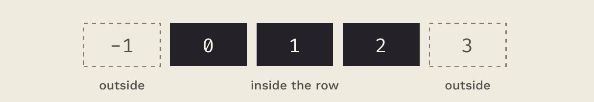
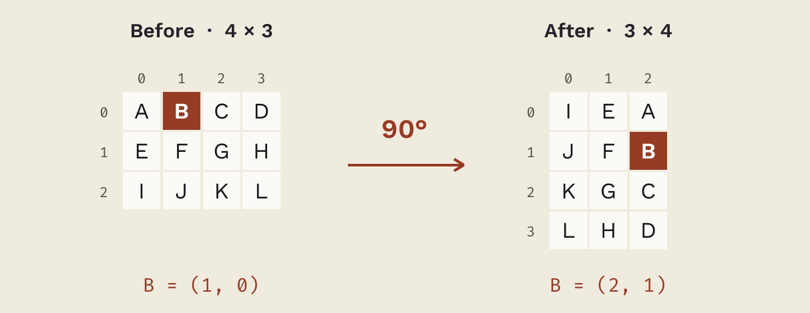
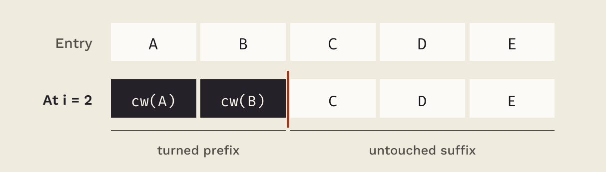
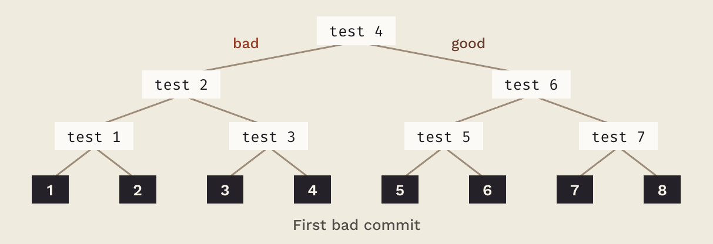

# The Software Engineer’s Introduction to Formal Verification

*With Lean, Rocq, and Dafny · Third edition · Pud.dev*

Rotate an image clockwise through 90 degrees. Which pixel should appear in the top-left corner? The one that used to be at the bottom left. A single test can settle that for a particular photograph. A useful image library owes its caller the same answer for every photograph, and a corresponding answer for every other pixel.

Formal verification gives a promise like that a precise mathematical meaning, then checks whether a program or its model keeps it. We’ll start with an array bounds check. The running example is small enough to draw, the executable examples are in TypeScript, and the proofs fit in an editor alongside them. You can work through the first four chapters with pencil and paper.

## Contents

1. [How to read a claim](#chapter-01)
2. [Draw the specification](#chapter-02)
3. [A proof on paper](#chapter-03)
4. [What counts as verification?](#chapter-04)
5. [Lean](#chapter-05)
6. [Rocq](#chapter-06)
7. [Dafny](#chapter-07)
8. [When a proof fails](#chapter-08)
9. [From a function to a system](#chapter-09)
10. [Read a page of mathematics](#chapter-10)
11. [The workbench](#chapter-11)
12. [Desk reference](#chapter-12)

<a id="chapter-01"></a>

## 1. How to read a claim

### Three boxes

Draw three boxes in a row. Number them 0, 1, 2. Which integers are valid indices? You could list them in a **set**, `X = {0, 1, 2}`. A set records which values belong. Their order inside the braces makes no difference.



The sentence `2 ∈ X` says “2 belongs to X.” It is true. Change 2 to 3 and the sentence becomes false. Each sentence is a **proposition**, a claim to which it makes sense to assign a truth value.

Give the row a width `w` and call the proposed index `x`. Both are **integers**. Count in steps of one in either direction from zero and you get them all. The symbol for their set is `ℤ`. You’ll also meet `ℕ`, the **natural numbers**, here starting at zero. The difference matters even for subtraction. In Lean and Rocq, `0 - 1` gives `-1` on integers and `0` on naturals.

> `0 ≤ x ∧ x < w`

That’s the array bounds check. Say it aloud as “x is at least zero **and** strictly less than w.” The symbol `∧` joins the conditions. A paper often writes the same thing more compactly as `0 ≤ x < w`. Give this expression a name, `InRow(w, x)`, and you have a **predicate**. Supply it with the values 3 and 2, and it expresses a true proposition. Supply 3 and 3, and it expresses a false one.

### Who chooses first?

“Some index lies in this row” asks for one example. For a row of width three, choose `x = 1` and check `0 ≤ 1 < 3`. That index is a **witness**. “Every index in this row stays in range when the row is reversed” gives you a different job. Someone else gets to choose the index, and your argument must work for their choice.

The symbols for those two instructions are `∃`, “there exists,” and `∀`, “for every.” Their order changes the job. Read the next claim from left to right.

> `∀ x ∈ ℤ, ∃ y ∈ ℤ, y > x`

For every integer x, there is an integer y greater than x. You name x first. Whatever you pick, I can return `x + 1`. The rule supplies a witness for each possible x.

Now reverse the choices. `∃ y ∈ ℤ, ∀ x ∈ ℤ, y > x` would give us an integer bigger than every integer. For **each proposed y**, choose `x = y`. The final requirement becomes `y > y`. This explains why picking one fixed x, say 7, could never dispose of the claim. The proposed y could still be 8. A **counterexample** has to defeat the claim with its quantifiers in the order given. [Quantifiers and equality](https://lean-lang.org/theorem_proving_in_lean4/Quantifiers-and-Equality/)

One more symbol belongs beside the bounds check. `P → Q` says “if P holds, then Q holds.” To refute it, find a case with P true and Q false. For an image decoder, “if the decoder accepts an index, the index is in range” rules out accepting index 3 in our three-box row. A decoder that rejects index 2 can still keep that promise. If it must accept every valid index as well, write `P ↔ Q`, “P if and only if Q.” Each direction has its own possible failure.

<a id="chapter-02"></a>

## 2. Draw the specification

### Follow the B

Our image is a **raster**, a rectangle of pixels. Give each pixel one byte, and use twelve different byte values so we can follow them by eye. The first row reads ABCD, the next EFGH, the last IJKL. An address is an ordered pair `(x, y)` with x counting columns to the right and y counting rows down from the top left. The first pixel is `(0, 0)`. B is at `(1, 0)`.



After the turn, read the rows again. They are IEA, JFB, KGC and LHD. The old top row has become the rightmost column. Rows 0, 1 and 2 have become columns 2, 1 and 0. To reverse a row index, subtract it from the last one, `h - 1`. Along each old row, the pixels now run from top to bottom, so the old column gives the new row.

> `cw(h, (x, y)) = (h - 1 - y, x)`

Here `h` is the **height before the turn**. The width will matter when we check where the result can lie.

### From pixels to TypeScript

A TypeScript `Point` has two `bigint` coordinates. The `n` suffix on `1n` makes it an integer of that type.

```typescript
export type Point = Readonly<{ x: bigint; y: bigint }>;

// h always means the height before the clockwise turn.
export function cw(h: bigint, p: Point): Point {
  return { x: h - 1n - p.y, y: p.x };
}
```

This is an executable model of the address calculation. Pillow provides an independent image operation for comparison. Its pixel addresses also start at the top left. Applied to the twelve labelled bytes, its `Transpose.ROTATE_270` operation gives the same four rows. Pillow measures positive rotation angles counterclockwise, so 270 degrees gives a 90-degree clockwise turn. [TypeScript examples](examples.ts) · [Pillow coordinates](https://pillow.readthedocs.io/en/stable/handbook/concepts.html#coordinate-system) · [Pillow image operations](https://pillow.readthedocs.io/en/stable/handbook/tutorial.html#geometrical-transforms)

A **specification** says what counts as correct behaviour. Start with the address. A point is *inside* when each coordinate passes its own bounds check.

> `Inside(w, h, (x, y)) = (0 ≤ x < w) ∧ (0 ≤ y < h)`

This is the Boolean version used by the TypeScript examples.

```typescript
export function inside(w: bigint, h: bigint, p: Point): boolean {
  return 0n <= p.x && p.x < w && 0n <= p.y && p.y < h;
}
```

### Two promises about one picture

Let w and h range over integers and p over pairs of integers. The following claim gives our function its first obligation.

> `∀ w, h, p, Inside(w, h, p) → Inside(h, w, cw(h, p))`

Left of the implication is what you get to assume. Right of it is what you must show. Notice the exchanged dimensions. For B the conclusion is `Inside(3, 4, (2, 1))`. At width zero, the premise is false for every point. An API that accepts or rejects empty rasters needs to make that choice separately.

What would happen if `cw` simply returned `(0, 0)`? Any image containing a legal pixel has positive width and height. Its turned image therefore contains `(0, 0)` too. Every source pixel could land in that one spot and the bounds theorem would still hold. We’ll add the ability to recover the original address in chapter 3.

A caller handing over actual pixels also expects their **values** to travel. Let `input[row][column]` mean the byte at that row and column, and keep the input intact while constructing the output. For every valid source address the required value is

> `output[x][h - 1 - y] = input[y][x]`.

For B that means `output[1][2] = input[0][1]`. You could compute every destination correctly, then write a zero byte at each one. The address calculation and the copy each have something to prove.

<a id="chapter-03"></a>

## 3. A proof on paper

### Four bounds

Pick an arbitrary valid pixel address `(x, y)`. “Arbitrary” means you must leave the numbers unspecified. B helped us discover the formula. Now anyone may supply a legal address, and we owe them the same argument. Opening up `Inside` gives us four facts.

```text
0 ≤ x       x < w       0 ≤ y       y < h
```

The new address is `(h - 1 - y, x)` and its raster is h columns wide by w rows high. Write down the four bounds that must hold there.

| Required bound | Reason |
| --- | --- |
| `0 ≤ h - 1 - y` | Since `y < h` and both are integers, `y ≤ h - 1`. Subtract y from both sides. |
| `h - 1 - y < h` | Subtracting a nonnegative y from `h - 1` gives at most `h - 1`, already below h. |
| `0 ≤ x` | This is the old lower bound on x. |
| `x < w` | This is the old upper bound on x. |

The first row spends a fact about integers that’s easy to miss. Try to use the same argument for fractional coordinates. With `h = 3` and `y = 2.5` the old bounds admit y, but the new x is `-0.5`. Naming the domain was part of the proof.

These are all steps in **linear arithmetic**. Sums, differences and multiplication by fixed integer constants stay within it. Multiplying two unknowns, such as `w × h`, takes you outside it. Later we’ll be able to hand just the four bounds to an arithmetic tactic and let it finish.

We can give this result a name and use it again. A writer might call it a **lemma** if they have a later use in mind, or a **theorem** if it’s the claim they set out to prove. Either way, a caller gets to use the conclusion once its assumptions hold.

### Recover the old address

The rotated B sits at `(2, 1)`. Its new row, 1, tells us the old column. Its distance from the new right edge, zero, tells us the old row. The same reasoning gives the inverse for any turned address `(u, v)`. The width after the turn is the height we called h before it.

> `ccw(h, (u, v)) = (v, h - 1 - u)`

```typescript
export function ccw(h: bigint, p: Point): Point {
  return { x: p.y, y: h - 1n - p.x };
}
```

Apply the functions in succession. Parentheses tell you which call to make first.

```text
p                    = (x, y)
cw(h, p)             = (h - 1 - y, x)
ccw(h, cw(h, p))     = (x, h - 1 - (h - 1 - y))
                     = (x, y)
```

For the last step, call `h - 1` by the shorter name m. Then `m - (m - y) = m - m + y = y`. The x coordinate was copied through twice. Equality of both coordinates gives equality of the two ordered pairs.

Where did this argument use the bounds? Nowhere. It returns `(-40, 600)` to `(-40, 600)` as readily as it restores B. The bounds theorem needs a legal input because it promises a legal output. The undo theorem is an algebraic identity over every integer pair. Stating each with just the assumptions it needs will pay off when one proof calls another.

<a id="chapter-04"></a>

## 4. What counts as verification?

### One raster and every raster

**Formal verification** uses mathematical reasoning to establish that a precisely described system satisfies a stated property. A machine-checked proof records enough detail for a program to check the deductions. In our bounds proof you can see how finitely many steps cover infinitely many inputs. The deduction from `y < h` to `y ≤ h - 1` works however large h is.

The twelve-letter image answers a different question. Feed it to an image library and compare the output with IEA, JFB, KGC, LHD. A passing test checks the pixels, the order of the bytes and the dimensions together for that case. A **property-based test** can generate many rectangles and check the byte equation at each valid address. A **differential test** can run two implementations, such as the TypeScript pixel copy and Pillow, on the same input and compare their results. A single disagreement gives you a case to investigate. Agreement covers the inputs exercised.

A **model checker** takes initial states, possible next steps and a property. For a finite configuration an explicit-state checker such as TLC can explore every reachable state. If a state breaks a safety rule, the path to it explains how the system got there. Chapter 9 has a two-account example where the order of a reader’s and a writer’s steps matters. [Lamport on the TLA+ tools](https://lamport.azurewebsites.net/tla/tools.html)

### What the caller can assume

Suppose a sampler produces a valid pixel address. Its caller can feed that address to a function that requires one. The **postcondition** of the first routine supplies the **precondition** of the second. The two promises fit together without either caller having to inspect the other routine’s code.

This idea appears in papers as a **Hoare triple**, `{P} C {Q}`. Start command C with P true. If C terminates normally, Q must hold afterwards. That’s *partial correctness*. *Total correctness* also requires C to terminate. A loop that runs forever would keep the partial promise vacuously. Later we’ll give the rotation loop a quantity that gets smaller until it has to stop. [Hoare logic in Software Foundations](https://softwarefoundations.cis.upenn.edu/plf-current/Hoare.html)

A contract also chooses its arithmetic. The coordinate model uses exact signed integers, represented in TypeScript by `bigint`. A caller taking coordinates as JavaScript `number` values has additional work. Fractions, infinities and `NaN` can all cross that interface. For the byte buffer, the companion validates positive, safe-integer dimensions and checks them against the buffer’s length. A type assertion alone would perform none of those checks.

### A midpoint that turns negative

In 2006 Joshua Bloch described a midpoint overflow in the JDK’s binary search. A binary search keeps two inclusive indices, lo and hi, and probes their midpoint. On paper their average lies between them. The Java implementation added the indices as signed 32-bit `int` values before dividing by two. Such an integer ranges from `−2³¹` through `2³¹ − 1`. [Joshua Bloch’s account](https://research.google/blog/extra-extra-read-all-about-it-nearly-all-binary-searches-and-mergesorts-are-broken/) · [Java integer addition](https://docs.oracle.com/javase/specs/jls/se21/html/jls-15.html#jls-15.18.2)

Here is the failure in TypeScript. Ordinary JavaScript addition uses `number` and represents these particular sums exactly. The explicit `| 0` keeps the low 32 bits and interprets them as signed. `Math.trunc` reproduces Java integer division toward zero.

```typescript
export function brokenMidpoint32(lo: number, hi: number): number {
  const sum = (lo + hi) | 0;
  return Math.trunc(sum / 2);
}
```

Give the array indices 0 through `2³⁰`, store i at index i, and search for `2³⁰`. Eventually the two inclusive indices are `2³⁰ - 1` and `2³⁰`. Their sum still fits. The probe chooses the lower one and the search advances lo. Now `lo = hi = 2³⁰`. Their mathematical sum is `2³¹`, which wraps to `−2³¹`. The resulting midpoint is `−2³⁰`. The array has a billion entries, but you can reproduce the bad calculation with a call using just two numbers.

```typescript
export function midpoint(lo: number, hi: number): number {
  return lo + Math.floor((hi - lo) / 2);
}
```

Why does the replacement work? Assume integer indices with `0 ≤ lo ≤ hi ≤ 2³¹ − 1`. The difference `hi - lo` is between zero and the largest signed integer. Taking half, rounded down, stays between zero and that difference. Add lo and the result lies between lo and hi, so the addition also fits. Since the difference is nonnegative, rounding down has the same effect as Java’s truncation toward zero. Those bounds justify both intermediate operations on the original machine. Chapter 10 uses this midpoint in a search where we can also prove how many probes are necessary. [Executable midpoint examples](examples.ts)

<a id="chapter-05"></a>

## 5. Lean

### A point and a proof about it

Lean lets you put a function and its proof in one language. The point below has two fields of type `Int`, Lean’s arbitrary-precision signed integer. A colon gives a type, and `:=` introduces a definition’s body. Function calls use spaces. Read `cw h p` as `cw(h, p)`. [Lean companion](proofs/Turn.lean)

```lean
structure Pt where
  x : Int
  y : Int
  deriving Repr, DecidableEq

def Inside (w h : Int) (p : Pt) : Prop :=
  (0 ≤ p.x ∧ p.x < w) ∧ (0 ≤ p.y ∧ p.y < h)

def cw (h : Int) (p : Pt) : Pt :=
  ⟨h - 1 - p.y, p.x⟩
```

The angle brackets construct the expected record from its fields in order. `deriving` asks Lean for code to display a point and decide whether two concrete points are equal. The single example below proves where B goes. `rfl` works because both sides compute to the same point. If you expect `⟨1, 2⟩` on the right, they cease to agree.

```lean
example : cw 3 ⟨1, 0⟩ = ⟨2, 1⟩ := rfl
```

There are three levels to keep straight. `p : Pt` is a point. `Inside w h p : Prop` is a proposition about that point. If you have evidence that it lies within the given dimensions, the evidence can have its own name, `hp : Inside w h p`. The proposition itself gives the **type of its proof**. A proof of `P → Q` is a function that takes evidence for P and returns evidence for Q. This correspondence is called *propositions as types*. [Propositions and proofs](https://lean-lang.org/theorem_proving_in_lean4/Propositions-and-Proofs/)

### Inside the goal window

```lean
theorem cw_inside {w h : Int} {p : Pt}
    (hp : Inside w h p) : Inside h w (cw h p) := by
  rcases hp with ⟨⟨hx0, hxw⟩, ⟨hy0, hyh⟩⟩
  change (0 ≤ h - 1 - p.y ∧ h - 1 - p.y < h) ∧
         (0 ≤ p.x ∧ p.x < w)
  constructor
  · constructor <;> omega
  · exact ⟨hx0, hxw⟩
```

Read the first two lines as a signature. The width, height and point in braces can usually be inferred. Supply evidence `hp` for the old bounds and the theorem produces evidence for the new ones. After `by` come **tactics**, commands that construct a proof term. Lean’s **kernel** checks the resulting term. [Lean tactics](https://lean-lang.org/theorem_proving_in_lean4/Tactics/) · [Lean’s kernel](https://lean-lang.org/doc/reference/latest/Elaboration-and-Compilation/)

`rcases` unpacks the input into four named inequalities. `change` spells out the result in coordinates. Lean checks that unfolding the definitions actually gives the proposed expression. The first `constructor` splits the outer “and” into one goal per coordinate.

The first bullet splits the x inequalities and sends both to `omega`, an arithmetic tactic for integers and naturals. The punctuation `<;>` applies the tactic on its right to each goal created on its left. Just before the last line, the relevant facts and the outstanding goal look like this.

```text
hx0 : 0 ≤ p.x         hxw : p.x < w
⊢ 0 ≤ p.x ∧ p.x < w
```

The turnstile `⊢` means “show this.” The goal asks for the pair of facts already sitting above it. `exact ⟨hx0, hxw⟩` supplies them. These are the last two rows of the paper proof, where the old x became the new y.

### Carry the bounds with the point

```lean
structure Cell (w h : Int) where
  point : Pt
  valid : Inside w h point

def rotateCell {w h : Int} (c : Cell w h) : Cell h w :=
  ⟨cw h c.point, cw_inside c.valid⟩
```

The first field is an address. The second is evidence that *this address* fits dimensions w and h. This is a **dependent type**. Values such as w and h can appear in the type itself. `Cell 4 3` permits `(3, 2)`. Try to use x equal to 4 and the required evidence would include `4 < 4`.

Two unrelated four-by-three images accept exactly the same `Cell 4 3`. The dimensions determine which coordinates fit. To identify which image supplied a byte, you’d need to represent the image or its identity as well. The type here carries dimensions and an address.

In `rotateCell` the new coordinates come from `cw`, and the previous theorem produces the evidence needed to construct a `Cell h w`. A TypeScript brand can communicate that a constructor checked the bounds. Lean can also check the construction of the evidence each caller passes along. When Lean compiles the program it erases fields holding proofs in `Prop`. An image decoder still has to establish its input bounds at the point where outside data enters. [Dependent types](https://lean-lang.org/theorem_proving_in_lean4/Dependent-Type-Theory/) · [Propositions in compiled code](https://lean-lang.org/doc/reference/latest/The-Type-System/Propositions/)

### Can two addresses collide?

Suppose two source addresses have the same destination. Apply undo to that one destination. Can it return two different sources? The whole argument fits into two tactic lines.

```lean
theorem no_merge (h : Int) (p q : Pt)
    (same : cw h p = cw h q) : p = q := by
  have back := congrArg (ccw h) same
  simpa only [undo_cw] using back
```

A function with this property is **injective**. The hypothesis `same` says the two destinations are equal. `congrArg` applies a function to both sides of an equality. With `ccw h` as that function, `back` is evidence for

> `ccw h (cw h p) = ccw h (cw h q)`.

The companion proves `undo_cw` by the cancellation from chapter 3. Simplify each side using that lemma and what remains is `p = q`. That’s the job of `simpa only [undo_cw] using back`. Once you have an undo law, the argument works for any pair of functions with that law.

To see the assumptions under it, ask Lean for `#print axioms no_merge`. An **axiom** is a statement accepted as a starting point. This proof reports `propext` and `Quot.sound`, principles about equivalence of propositions and quotient types used by its dependencies. A declaration filled with the placeholder `sorry` would make its dependants report `sorryAx`. [Axioms and computation](https://lean-lang.org/theorem_proving_in_lean4/Axioms-and-Computation/)

<a id="chapter-06"></a>

## 6. Rocq

### The type of an equality

An image-processing pipeline can carry a trace of sampled addresses alongside an image. A trace can visit A, then B, then A again. Rotating the trace and undoing the rotation ought to recover both visits to A, in their original positions. We’ll prove this in Rocq, formerly Coq. Its language for definitions and terms is called **Gallina**. [Rocq companion](proofs/Turn.v) · [The Rocq Prover](https://rocq-prover.org/)

```coq
From Stdlib Require Import ZArith Lia List.
Import ListNotations.
Open Scope Z_scope.

Record Pt := pt { px : Z; py : Z }.

Definition inside (w h : Z) (p : Pt) : Prop :=
  (0 <= px p < w) /\ (0 <= py p < h).

Definition cw (h : Z) (p : Pt) : Pt :=
  pt (h - 1 - py p) (px p).

Definition ccw (h : Z) (q : Pt) : Pt :=
  pt (py q) (h - 1 - px q).

Example turn_one : cw 3 (pt 1 0) = pt 2 1.
Proof. reflexivity. Qed.
```

`Z` is the type of signed integers, and `Open Scope Z_scope` gives the arithmetic symbols that interpretation. The constructor `pt` builds a point. The field readers `px` and `py` retrieve its coordinates. `/\` means “and.” Each command ends with a period.

In an editor, enter `Check (cw 3 (pt 1 0) = pt 2 1).` The answer is `Prop`. Now enter `Check turn_one.` The answer is the equality itself, `cw 3 (pt 1 0) = pt 2 1`. The first command inspected a proposition. The second inspected the proof named by `Example`. Between `Proof.` and `Qed.`, `reflexivity.` establishes that both expressions compute to the same point. [Proof objects in Software Foundations](https://softwarefoundations.cis.upenn.edu/lf-current/ProofObjects.html)

### Reading the tactics

```coq
Theorem cw_inside : forall w h p,
  inside w h p -> inside h w (cw h p).
Proof.
  intros w h [x y] [[Hx0 Hxw] [Hy0 Hyh]].
  cbn [px py] in Hx0, Hxw, Hy0, Hyh.
  change ((0 <= h - 1 - y < h) /\ (0 <= x < w)).
  split.
  - split; lia.
  - exact (conj Hx0 Hxw).
Qed.
```

The signature gives you the order of work. `forall` introduces an arbitrary width, height and point. The arrow adds an assumption about that point. `intros` brings the inputs and the assumption into the proof. The pattern `[x y]` opens the point record. The nested brackets give names to the four bounds.

`cbn [px py]` reduces field reads, so `Hxw` now says `x < w`. `change` spells out the destination bounds. `split` creates one goal for each coordinate. In the first branch, `split; lia.` separates the two inequalities and asks `lia` to settle each by linear integer arithmetic. In the second branch, `conj Hx0 Hxw` constructs a conjunction from the two old x bounds.

Here too the tactics build a term the kernel checks. Ask for `Print Assumptions cw_inside.` This companion reports “Closed under the global context.” Closing an unfinished declaration with `Admitted.` would instead introduce an assumption that follows it into any dependent proof. [Rocq proof commands](https://rocq-prover.org/doc/V9.3.0/refman/proof-engine/vernacular-commands.html)

### From one sample to a trace

A set containing A and B forgets the second visit to A. A list preserves each visit. There are only two ways to construct a list in Rocq. Start with the empty list `[]`, or put an element `p` in front of another list `tail` to form `p :: tail`. A function over lists can give a rule for each shape.

```coq
Fixpoint turnAll (h : Z) (ps : list Pt) : list Pt :=
  match ps with
  | [] => []
  | p :: tail => cw h p :: turnAll h tail
  end.
```

`Fixpoint` introduces a recursive definition. The second rule turns the first point, then applies the same function to the tail. Rocq can see that the tail is a smaller part of the original list, so the recursion terminates. For `[A, B, A]` the calls receive `[A, B, A]`, `[B, A]`, `[A]`, then `[]`.

The library function `map f` applies a function f to every element in order. Mapping undo over the turned trace should recover the original list. Equality of lists covers the length, each position and every repeated visit in one statement.

```coq
Theorem undo_all : forall h ps,
  map (ccw h) (turnAll h ps) = ps.
Proof.
  intros h ps.
  induction ps as [| p tail IH].
  - reflexivity.
  - cbn [turnAll map].
    rewrite undo_cw, IH.
    reflexivity.
Qed.
```

### Why induction works

Start with an empty trace. Turning it and mapping undo over it both return `[]`. That proves the **base case**, discharged by the first `reflexivity`.

Now suppose you can restore the tail of a trace. Prepend one more point p. What new work is there? Undo the turn of p, and use what you know about the tail. The command `induction` provides exactly that smaller result as the **induction hypothesis**, here named `IH`. After `cbn` expands one layer of each function, the remaining equality reads

```text
ccw h (cw h p) :: map (ccw h) (turnAll h tail)
= p :: tail
```

`rewrite undo_cw, IH` replaces the head on the left by p and its tail by `tail`. Both sides now have the same head and the same tail. The final `reflexivity` closes the proof.

Why may you assume part of the result you’re trying to prove? Induction grants it for the smaller tail. Take any finite trace, start at its end with `[]`, and build the trace by prepending the points in reverse order. The base case supplies the first proof. Each use of the step gives a proof for one more point. That construction reaches every finite list. [Induction in Software Foundations](https://softwarefoundations.cis.upenn.edu/lf-current/Induction.html)

If a program needs the executable definition, Rocq can extract functions such as `turnAll` to OCaml. An application calling that code also relies on the extraction and target compilation steps. A handwritten TypeScript implementation would need its own connection to the checked definition. [Rocq extraction](https://rocq-prover.org/doc/V9.3.0/refman/addendum/extraction.html)

<a id="chapter-07"></a>

## 7. Dafny

### A lemma with an empty body

Suppose the sampler keeps its trace in a mutable array. We want to replace the address stored in each slot with its turned address. Two entries may name the same pixel. Each entry will stay in its original slot. The raster bytes live in a separate buffer.

Dafny can describe pure functions and mutable methods in the same file. Its `int` denotes a mathematical integer. Here are the point definition, the bounds predicate and the forward turn. [Dafny companion](proofs/Turn.dfy)

```dafny
datatype Pt = Pt(x: int, y: int)

predicate Inside(w: int, h: int, p: Pt)
{
  0 <= p.x < w && 0 <= p.y < h
}

function Cw(h: int, p: Pt): Pt
{
  Pt(h - 1 - p.y, p.x)
}
```

```dafny
lemma CwInside(w: int, h: int, p: Pt)
  requires Inside(w, h, p)
  ensures Inside(h, w, Cw(h, p))
{
}
```

The last pair of braces is empty. This lemma gives Dafny enough information to prove it automatically. Whoever uses the lemma must supply its `requires` clause. They may then rely on its `ensures` clause. A second lemma in the file, `UndoCw`, establishes the round trip on all signed points.

### Could the new x reach the edge?

Dafny translates proof obligations through Boogie and gives them to Z3, an **SMT solver**. SMT stands for *satisfiability modulo theories*. The theories give meaning to operations on integers, records and other values. The solver can ask whether some assignment of values makes a collection of conditions true all at once. An explicit `assume` would add a premise without proving it. [Dafny verification guide](https://dafny.org/v4.11.0/VerificationOptimization/VerificationOptimization) · [Dafny reference](https://dafny.org/v4.11.0/DafnyRef/DafnyRef)

One **verification condition** asks whether the upper x bound follows from the input bounds. To see the solver’s job, imagine trying to refute that implication. Keep the premises and add the negation of the desired conclusion.

```text
0 ≤ x < w
0 ≤ y < h
h - 1 - y ≥ h
```

Subtract h from the last line. It becomes `-1 - y ≥ 0`, which gives `y ≤ -1`. The second line gives `y ≥ 0`. No integer satisfies both. The conditions are **unsatisfiable**, so there is no assignment that breaks this bound. The verifier may group several conditions into a query.

If the last line instead read `h - y ≥ h`, a one-pixel image would supply a witness. Its point `(0, 0)` would produce new x equal to 1 at height 1. This is the off-by-one bug we’ll try in chapter 8.

A solver may also time out. A timeout alone leaves the mathematical question open. An intermediate `assert` asks the solver to establish a smaller fact it can then use. A named lemma lets other proofs use the fact too. Linear integer arithmetic has a decision procedure. Some questions about arbitrary programs, including whether an arbitrary program on a given input ever halts, admit no procedure that always terminates with the correct yes or no. [Verification optimisation](https://dafny.org/v4.11.0/VerificationOptimization/VerificationOptimization) · [MIT on computability](https://ocw.mit.edu/courses/6-006-introduction-to-algorithms-fall-2011/a2ee5c645c0c690e76f5d0db4807edcd_moPtwq_cVH8.pdf)

### The array before and after a call

```dafny
method TurnInPlace(h: int, a: array<Pt>)
  modifies a
  ensures forall k :: 0 <= k < a.Length ==>
    a[k] == Cw(h, old(a[k]))
```

`modifies a` is a **frame** clause. It permits writes to the array object a. If a caller holds a second reference to that object, it sees the writes through that reference too. Other objects that existed on entry are outside this permission.

In the postcondition, `old(a[k])` reads slot k as it stood on entry. The unqualified `a[k]` reads it on return. For every valid k, those two values must be related by `Cw`. The method works even on repeated or out-of-bounds sample coordinates because its contract promises this arithmetic relation for each entry. Bounds on a particular trace can be established by a caller using `CwInside`.



In the diagram A through E stand for *addresses stored in trace slots*. The vertical line separates the finished prefix from the unread suffix. Pause at any loop guard and you should be able to say what is in each region. A claim true at every such visit is a **loop invariant**.

### One more finished slot

```dafny
{
  ghost var before := a[..];
  var i := 0;
  while i < a.Length
    invariant 0 <= i <= a.Length
    invariant forall k :: 0 <= k < i ==>
      a[k] == Cw(h, before[k])
    invariant forall k :: i <= k < a.Length ==>
      a[k] == before[k]
    decreases a.Length - i
  {
    a[i] := Cw(h, a[i]);
    i := i + 1;
  }
}
```

`before` is a **ghost** variable. It holds an immutable sequence of the entry values, for use in the proof. Dafny erases it from the executable. The variable i is the first slot left to process.

**Entry.** At `i = 0` the empty prefix satisfies its rule and the entire array agrees with the fresh snapshot. Zero also lies between zero and the array length, even for an empty trace.

**One iteration.** Suppose all three invariants hold and `i < a.Length`. The suffix rule gives `a[i] = before[i]` before the write. The assignment therefore places `Cw(h, before[i])` in slot i. Each slot strictly to its left keeps its already-correct turned address because the assignment writes only to i. Each slot strictly to its right still agrees with the snapshot for the same reason. When i increases by one, the newly written slot joins the prefix. Finally, since the old i and the length are integers, the guard gives `i + 1 ≤ a.Length`. That establishes the index bound for the next guard as well.

**Exit.** The guard is false, so `i ≥ a.Length`. The index invariant gives `i ≤ a.Length`. Hence i equals the length and the prefix rule now covers every slot. It is exactly the promised relationship to the entry values.

For termination, count the remaining slots. `a.Length - i` is positive whenever the body runs and falls by one per iteration. A nonnegative integer cannot fall forever. The `decreases` clause asks Dafny to check that last part of total correctness. [Dafny on loops and termination](https://dafny.org/v4.11.0/OnlineTutorial/guide)

<a id="chapter-08"></a>

## 8. When a proof fails

### A bad program or a missing fact?

In a copy of a companion file, remove the `- 1` from the forward turn. Keep the inverse and the desired results as written. Here is what the checkers encounter.

| Tool | First clues |
| --- | --- |
| Lean | `rfl` fails for B. The hand-expanded bounds in `change` also disagree with the new definition. |
| Rocq | The compiler stops at `turn_one`. The computed point differs from `pt 2 1`. |
| Dafny | The new x upper bound in `CwInside` fails, and so does the round trip in `UndoCw`. |

At `y = 0` the new x is h. The last legal column is `h - 1`. Every top-row pixel supplies a failing call, including the only pixel in a one-by-one image. Here a checker’s complaint leads straight to an input you can run.

Restore the correct turn. This time remove only the *suffix invariant* from the Dafny loop. Consider a one-slot array at height 2. At `i = 0` imagine the snapshot contains `[(0, 0)]` while the current array contains `[(0, 1)]`. The index bound holds and the finished prefix is empty. Both surviving invariants admit the state.

The next write would turn the current `(0, 1)` into `(0, 0)`. The postcondition asks for the turn of the original `(0, 0)`, namely `(1, 0)`. The real loop never reaches that starting state. The proof, however, has lost the fact that rules it out. Restoring the suffix invariant repairs the proof while leaving the executable assignments as they were.

### A green check for a reflection

A subtler experiment passes all four verification units in the original Dafny companion. Change both turns to swap the coordinates. The map `(x, y) ↦ (y, x)` reflects addresses across the line `y = x` and exchanges the raster’s dimensions. Every legal point still lands in range. Swapping twice restores the starting point. The loop faithfully applies the new function to each slot.

What distinguishes a clockwise turn? Look at B. A clockwise turn sends `(1, 0)` to `(2, 1)`. A reflection sends it to `(0, 1)`. Lean and Rocq already contain that labelled check. To describe the distinction for every point, use B’s distance from two edges. The old column becomes the new row. The distance from the new right edge equals the distance from the old top edge.

```text
new.y = old.x
(h - 1) - new.x = old.y
```

For a legal pixel the distances count steps to an edge. As algebra, the equations make sense for every integer point. A fixed input determines both output coordinates. Solving the second gives `new.x = h - 1 - old.y`. An implementation could use arithmetic or a lookup table. The equations give either one the same obligation. A separately written undo still needs the round-trip theorem. A correct forward turn could coexist with an undo that always returned the origin.

### Checking the direction in Dafny

The fourth companion file checks the orientation directly. Its `include` line brings in the functions from the original file.

```dafny
include "Turn.dfy"

lemma Clockwise(h: int, p: Pt)
  ensures Cw(h, p).y == p.x
  ensures (h - 1) - Cw(h, p).x == p.y
{
}
```

From the book directory, run `dafny verify proofs/Turn.dfy` and `dafny verify proofs/Orientation.dfy`. The first reports `4 verified, 0 errors`. The second reports `1 verified, 0 errors` for the new lemma. [Base proofs](proofs/Turn.dfy) · [Orientation lab](proofs/Orientation.dfy)

For the experiment, copy both files into one directory. In that copy make `Cw` return `Pt(p.y, p.x)` and make `Ccw` return `Pt(q.y, q.x)`. Verify each file again. The original four units pass. The orientation check fails on its **second** equation. B shows exactly why. The reflected point’s new x is zero, two columns from the right edge, whereas B started zero rows from the top. The first equation still holds. The new postcondition captures the geometric difference.

### What has to be maintained?

| Change | Where the proof lives |
| --- | --- |
| An API must return a sample fitting the new dimensions. | Lean’s `rotateCell` packages the new address and its bounds for the next caller. |
| A trace changes representation. | Rocq’s structural proof follows the list constructors. A tree would require cases for its own constructors. |
| A method rewrites shared storage. | Dafny’s contract names the array it may change and describes each slot’s value relative to entry. Its loop records the facts needed between writes. |

Lean and Rocq both support dependent types, induction and proof automation. Dafny has recursive functions and inductive lemmas as well as mutable methods. The examples emphasise three different jobs a verification tool can do with the same calculation.

The usual Lean and Rocq tactics build proof terms that a kernel checks under its theory’s assumptions. In a standard Dafny run the guarantee also depends on a faithful translation to verification conditions and correct answers from the solver. Shipping executable code can add a compiler, a foreign interface and a runtime to the chain of components you rely on. [Lean’s kernel](https://lean-lang.org/doc/reference/latest/Elaboration-and-Compilation/) · [Rocq extraction](https://rocq-prover.org/doc/V9.3.0/refman/addendum/extraction.html) · [Dafny’s verifier](https://dafny.org/v4.11.0/DafnyRef/DafnyRef)

<a id="chapter-09"></a>

## 9. From a function to a system

### Where the bytes go

Try the clockwise address formula on a two-by-two raster with rows AB and CD. A belongs at B’s address. Suppose a row-by-row scan writes A straight into that slot in the input buffer. When the scan reaches B, it reads A. Every address so far was computed correctly, and B has already been lost.

The TypeScript companion allocates fresh storage for the result. It expects a positive width and height, with one byte per pixel, stored left to right and then top to bottom.

```typescript
export function rotateRaster({ width: w, height: h, pixels }: Raster): Raster {
  if (!Number.isSafeInteger(w) || !Number.isSafeInteger(h) ||
      w <= 0 || h <= 0 || w * h !== pixels.length) {
    throw new RangeError("Expected a nonempty rectangular raster");
  }

  const out = new Uint8Array(pixels.length);
  for (let y = 0; y < h; y++) {
    for (let x = 0; x < w; x++) {
      out[x * h + (h - 1 - y)] = pixels[y * w + x];
    }
  }
  return { width: h, height: w, pixels: out };
}
```

An address `(x, y)` in a raster of width w has offset `y × w + x`. After the turn the row is x, the width is h, and the column is `h - 1 - y`. That accounts for both subscripts in the assignment. The desired two-by-two result has rows CA and DB. For the full twelve bytes, the returned width is 3 and the output reads IEA, JFB, KGC, LHD. [TypeScript pixel copy](examples.ts)

The nested loops visit each valid source address once. The separate output buffer lets every read see the original byte, provided the caller keeps the input stable during the call. If every destination has exactly one source, those writes fill the whole result and none can replace another. Chapter 10 establishes that last fact. The byte-copy argument here comes from reading this loop. The machine-checked Dafny method updates a trace of addresses held in array slots. The objects and postconditions differ.

### A transfer with a missing recipient

The PostgreSQL tutorial uses a bank transfer to explain transactions. Take two distinct accounts in the same currency, with integer balances measured in cents. If they start at a and b and the amount is d, the successful transition should take them to `(a - d, b + d)`. Its conservation law fits on one line. [PostgreSQL transaction tutorial](https://www.postgresql.org/docs/current/tutorial-transactions.html)

> `(a - d) + (b + d) = a + b`

The cancellation works even with negative numbers. If the bank also promises nonnegative balances, assume nonnegative starting balances, a positive d and sufficient funds in the source account. Require all results to fit the storage type. And decide when the numbers describe the database. After a debit and before its matching credit, the individual balances add to less than their starting total. Conservation is a claim about **committed states**.

For a transfer of 30 cents from balances `(100, 0)`, require the debit and credit to run in one transaction. Give each account a unique identifier. Subtract from the current source balance conditional on sufficient funds. Add to the current destination balance. Each update must affect exactly one intended row. Roll back on any failed check or error, including a missing destination. Assume this transfer makes only these two balance changes. A claim about the total across an entire ledger would also need to account for other writers, including deposits and withdrawals. PostgreSQL permits a successful update to match zero rows. Without the row-count check, a debit of 30 followed by a credit to a missing recipient could commit a total of 70. Atomicity alone would faithfully commit both statements as issued. [PostgreSQL update counts](https://www.postgresql.org/docs/current/sql-update.html#SQL-UPDATE-OUTPUTS)

### Two queries, two snapshots

Even a correct transfer can give a reader an apparent total of 130. Suppose the reader uses two ordinary queries under PostgreSQL’s **Read Committed** isolation level.

| Order | Event |
| --- | --- |
| 1 | The reader queries the source and sees its old 100. |
| 2 | The writer commits both changes. The balances are now 70 and 30. |
| 3 | The reader queries the destination and sees its new 30. |

The reader has put together values from two snapshots. A single ordinary query reading both accounts sees one consistent snapshot and returns either `(100, 0)` or `(70, 30)` in this history. The database never contained the pair `(100, 30)` in a committed state. The property needs both a transition that preserves the sum and a way of observing the pair at the same instant in the database history. [PostgreSQL Read Committed](https://www.postgresql.org/docs/current/transaction-iso.html#XACT-READ-COMMITTED)

A committed state with missing money is a **safety** failure. A finite history can exhibit it. “Every accepted transfer eventually receives a result” is a **liveness** claim. To prove progress you need assumptions about such things as a database coming back online and a waiting process getting another turn. Finite retries without a response might be the beginning of success or of an infinite wait. [TLA+ on safety and liveness](https://lamport.azurewebsites.net/tla/tools.html)

### Three real systems

**Cedar.** A Cedar authorisation request can match both a permit policy and a forbid policy. In the team’s executable Lean model, a satisfied forbid suffices to prove that the authoriser denies the request. The production implementation is written in Rust. The team generates inputs, runs both programs and compares their answers, using millions of differential tests to check the connection. The theorem ranges over the Lean model’s inputs. Each comparison exercises a particular path through the Rust implementation. [Cedar’s Lean model and Rust testing](https://aws.amazon.com/blogs/opensource/lean-into-verified-software-development/)

**CompCert.** A compiler replaces one program with another. CompCert’s proofs, written in Coq (now Rocq), connect a C abstract syntax tree to an assembly representation through a series of verified compilation passes. For a source program with defined behaviour, successful verified compilation produces a target whose observable behaviour is one the source semantics allows. That includes a program’s I/O and termination. The theorem permits a different choice of registers or instructions. The external assembler and linker have their own place in the path to an executable. [CompCert’s guarantee and compilation stages](https://compcert.org/man/manual001.html)

**IronFleet.** A replicated service can take many internal steps to carry out one abstract operation. The IronFleet authors used Dafny to relate distributed implementations to concise safety specifications for a Paxos-based replicated state machine and a sharded key-value store. They also proved progress properties under stated assumptions about the environment. This kind of **refinement** connects work done by several machines to a step a client is entitled to observe. Reading the progress assumptions tells you which delays the model permits. [IronFleet paper](https://pdos.csail.mit.edu/6.5840/papers/ironfleet.pdf)

<a id="chapter-10"></a>

## 10. Read a page of mathematics

### A bijection in four sentences

Here is the address argument at the pace you might encounter in a paper. Read it once for the claim. Then allow yourself a line of working for each sentence of the proof.

> **Theorem.** Let w and h be positive integers. Clockwise rotation is a bijection from the pixel addresses of a w by h raster to those of an h by w raster.
>
> **Proof.** The bounds lemma makes the map well-defined. It is injective by the left-inverse law. For surjectivity, take a target address `(u, v)`. The source address `(v, h - 1 - u)` maps to it. `∎`

A **bijection** gives each source address one destination, and each destination has *exactly one* source. Unpack “exactly one” into two obligations.

**At most one.** Suppose two sources mapped to a particular target. Applying undo to that target must recover each of those sources, by `ccw(h, cw(h, p)) = p`. So they were equal. This is **injectivity**. The three base proof files check the left-inverse law, and the Lean file also checks this deduction from it.

**At least one.** Choose any target `(u, v)` and find a source that turns into it. The proposed source has `x = v`, which satisfies `0 ≤ v < w`. It has `y = h - 1 - u`, in range because `0 ≤ u < h` and reversing an index preserves its bounds. Turning the proposed source gives `(h - 1 - (h - 1 - u), v) = (u, v)`. Such a source is called a **preimage**. This proof on paper establishes **surjectivity**. It uses the two functions in the opposite order from the checked left-inverse law.

“Well-defined” accounts for the input and output types. To declare this function *from* legal source addresses *to* legal target addresses, you owe the bounds lemma. The final square marks the end of the proof. Now return to the byte loop. Each source is read once, each destination receives one write by the bijection, and that write takes its value from the unmodified input. That supplies the argument for the row-first byte equation in chapter 2.

### Which commit broke the rotation?

An image library used to pass the twelve-byte test. Now it fails. Suppose the relevant history is a single line of commits numbered 0 through 8. Commit 0 is already known good and commit 8 is already known bad. Every commit can be built and tested. The test gives a repeatable yes or no, and once it fails, it fails at every later commit. A bisect can now identify the first bad revision. [Git bisect manual](https://git-scm.com/docs/git-bisect)

There are **eight** candidates for first bad, 1 through 8. Being known bad keeps 8 in the running. If all seven intervening commits are good, 8 introduced the failure. Commit 0 is the only endpoint we may discard at the outset.

Suppose you probe commit 4. If it is good, first bad must be 5, 6, 7 or 8. If it is bad, first bad must be 1, 2, 3 or 4. You can halve the surviving group again by testing 6 or 2. One more test separates the remaining pair.



Suppose the only evidence about the failure comes from yes-or-no test results. Why must *any* strategy sometimes use three fresh probes? Draw its decisions as a tree. A probe has two possible answers, so the first two probes can distinguish at most `2 × 2 = 4` outcomes, even when the second probe depends on the first answer. If eight possible first bad commits had to share those four outcomes, at least two would produce the same answers. The strategy would have to name the same commit for both, and one answer would be wrong. Three probes are therefore **necessary in the worst case**. The tree in the figure proves that three are also **sufficient**.

### Keeping the first bad commit in range

Here is the search in TypeScript, using the midpoint from chapter 4. The caller supplies the known endpoints and the test. The candidate interval is open on the good end and closed on the bad end, written `(good, bad]`.

```typescript
export function firstBad(
  good: number,
  bad: number,
  isBad: (revision: number) => boolean,
): number {
  while (bad - good > 1) {
    const mid = midpoint(good, bad);
    if (isBad(mid)) {
      bad = mid;
    } else {
      good = mid;
    }
  }
  return bad;
}
```

If `mid` is bad it stays a candidate, so that branch keeps it as the new bad endpoint. If `mid` is good, monotonicity rules out it and everything before it. While the endpoints differ by more than one, the midpoint lies strictly between them, so either update shortens the interval. When they become adjacent, `bad` is the only candidate. This also covers starting with adjacent endpoints. The loop then makes **zero fresh probes**. [Executable bisection](examples.ts)

More generally, for m candidates the worst-case lower bound is the smallest integer k with `2ᵏ ≥ m`. A binary decision tree of height k has at most `2ᵏ` leaves. Bisection attains the bound by splitting the candidates into groups whose sizes differ by at most one. If the starting count is at most `2ᵏ` and k is positive, the larger group has at most `2^(k - 1)` candidates. After at most k splits the group has size one. It makes at most three probes even for five candidates, and some cases finish in two. Actual Git histories can contain merges, and `git bisect skip` can leave several neighbouring commits unresolved. The counting argument relies on a linear history, a single transition and a definite answer at every probe. [Git bisect and skipped commits](https://git-scm.com/docs/git-bisect#_bisect_skip)

<a id="chapter-11"></a>

## 11. The workbench

### Five problems

**1. Empty rasters.** Add `w > 0 ∧ h > 0` as an explicit premise of the bounds theorem. Which deduction becomes possible for the first time? Then consider a function that must produce a valid sample address for every pair of dimensions it accepts. Under what conditions can it honour that contract?

**2. Clockwise or reflected?** Find the smallest square raster in which one labelled address distinguishes clockwise rotation from `(x, y) ↦ (y, x)`. The arrow `↦` reads “maps to.” Give the source and the two destinations.

**3. Four turns.** Turn an arbitrary `(x, y)` four times clockwise. Write down the dimensions beside the address each time. Before reading the proof, choose the height for the outermost call in a Lean theorem stating that four turns restore the address.

**4. The wrong subscript.** In a copy of the Dafny method, change the right-hand side of its assignment from `Cw(h, a[i])` to `Cw(h, a[0])`. Find the shortest sample array that can expose the mistake. Which value does the faulty second iteration actually read?

**5. A weakened equality.** Suppose a test merely checks that each original sample appears somewhere in the restored trace. Give one passing pair of traces that loses a repeated visit, and another that interchanges two visits. What would catch both errors?

### Four turns worked out

| Turns | Raster dimensions | Address |
| --- | --- | --- |
| 0 | `(w, h)` | `(x, y)` |
| 1 | `(h, w)` | `(h - 1 - y, x)` |
| 2 | `(w, h)` | `(w - 1 - x, h - 1 - y)` |
| 3 | `(h, w)` | `(y, w - 1 - x)` |
| 4 | `(w, h)` | `(x, y)` |

On the third turn, reversing the old y gives `h - 1 - (h - 1 - y) = y`. The fourth turn begins at height w, so w belongs to the **outermost** call. Here is the proof from the Lean companion.

```lean
theorem four_turns (w h : Int) (p : Pt) :
    cw w (cw h (cw w (cw h p))) = p := by
  cases p with
  | mk x y =>
    change Pt.mk (w - 1 - (w - 1 - x))
                 (h - 1 - (h - 1 - y)) = Pt.mk x y
    have xBack : w - 1 - (w - 1 - x) = x := by omega
    have yBack : h - 1 - (h - 1 - y) = y := by omega
    rw [xBack, yBack]
```

`cases p` opens the point record. `change` writes out both surviving subtractions, and `omega` proves each cancellation. The last line rewrites the two fields to x and y. This theorem concludes that four turns restore the address of any integer point. The table kept track of the dimensions. Applying the byte equation at each turn would let us carry an original byte along the same route.

### The other four solutions

**1. Empty rasters.** A legal x gives `0 ≤ x < w`, hence `w > 0`. The y bounds give `h > 0` in the same way. Both facts were already available. To *produce* a valid sample, positive dimensions are necessary and sufficient. Under those conditions `(0, 0)` is a witness. A function accepting zero width or height could instead return an optional sample. The workbook’s byte rotation rejects those dimensions at entry.

**2. Clockwise or reflected?** On a two-by-two square the top left, `(0, 0)`, rotates to `(1, 0)` and reflects to `(0, 0)`. A one-by-one square has only the origin, which both operations fix. An empty square offers no sample.

**4. The wrong subscript.** Take `h = 2` and start with `[(0, 0), (1, 1)]`. The correct result is `[(1, 0), (0, 1)]`. The faulty first iteration writes `(1, 0)` into slot zero. The second reads that *already turned* point and writes its turn, `(1, 1)`, into slot one. An empty trace never runs the body. With a single entry the two subscripts agree on the only iteration.

**5. A weakened equality.** Turning `[A, A]` into `[A]` loses a visit. Turning `[A, B]` into `[B, A]` changes the order. Both pass the membership test. It would even allow `[]` to become `[A]`, inventing a sample. Require the original length and the original address at every index. Together those conditions give the list equality proved in Rocq.

<a id="chapter-12"></a>

## 12. Desk reference

### Read the symbols aloud

| Notation | Reading | What to do with it |
| --- | --- | --- |
| `ℕ`, `ℤ` | Natural numbers, integers | Here the naturals begin at zero. Integers include negative whole numbers. |
| `x ∈ S` | x belongs to S | Check the condition for membership. |
| `≤`, `<`, `≠` | At most, strictly less than, unequal | Check which endpoint a bound includes. |
| `P ∧ Q` | P and Q | Supply evidence for both. |
| `P ∨ Q` | P or Q, possibly both | In a direct proof, establish either side. |
| `¬P` | P is false | Assume P and derive a contradiction. |
| `P → Q` | If P, then Q | Take P as a hypothesis and derive Q. |
| `P ↔ Q` | P if and only if Q | Prove each direction. |
| `∀ x, P(x)` | For every x, P holds | Take an arbitrary x in the stated domain. |
| `∃ x, P(x)` | Some x satisfies P | In a direct proof, exhibit x and establish P for it. |
| `h : P`, `⊢ Q` | h proves P, goal Q | Use available facts such as h to construct evidence for Q. |
| `f(g(x))` | f of g of x | Evaluate the inner call first. |
| `x ↦ f(x)` | x maps to f of x | Read off where a function sends the input. |
| `(a, b]` | Above a, up to and including b | For integer endpoints 0 and 8 the candidates are 1 through 8. |
| `∎` | End of proof | Check that the last conclusion is the original claim. |

The arrow does double duty. In `f : A → B` it describes a function from A to B. Between propositions, `P → Q` is implication. In Lean and Rocq, a function from a proof of P to a proof of Q supplies evidence for that implication.

### Run the companions

Run the commands from the directory containing this book. The proof files were checked with Lean 4.19.0, Rocq 9.3.0 with its standard library, and Dafny 4.11.0 with its bundled solver. An editor with language support lets you pause before a tactic and inspect its goal.

**TypeScript.** Run `bun examples.ts`. The workbook checks the coordinate round trip, the labelled pixel copy, the signed midpoint witness and all eight locations of the first bad commit. Its assertion about the original buffer also checks that the sample input still contains ABCD, EFGH, IJKL after the call. [TypeScript workbook](examples.ts)

**Lean.** Run `lean proofs/Turn.lean`. The file prints the axioms of four named theorems. In the checked version each reports `propext` and `Quot.sound`. Its integer arithmetic uses the `omega` tactic supplied with this toolchain. [Lean companion](proofs/Turn.lean) · [Install Lean](https://lean-lang.org/install/)

**Rocq.** Run `rocq compile proofs/Turn.v`. It prints “Closed under the global context” three times, once for each queried theorem. Compilation writes its artefacts beside the source. [Rocq companion](proofs/Turn.v) · [Install Rocq](https://rocq-prover.org/install)

**Dafny.** Run `dafny verify proofs/Turn.dfy` for the four base units, then `dafny verify proofs/Orientation.dfy` for the separate orientation check. Chapter 8 gives the reflection that separates their verdicts. [Dafny companion](proofs/Turn.dfy) · [Orientation lab](proofs/Orientation.dfy) · [Install Dafny](https://dafny.org/latest/Installation)

### Further reading

For **Lean**, try writing an implication as a function. In a proof with two quantifiers, mark each place the writer gets to choose a value and each place they must accept one. [Propositions and proofs](https://lean-lang.org/theorem_proving_in_lean4/Propositions-and-Proofs/) · [Quantifiers and equality](https://lean-lang.org/theorem_proving_in_lean4/Quantifiers-and-Equality/)

For **Rocq**, open an interactive exercise in *Software Foundations*. Stop just after `induction` and translate the induction hypothesis into English. The particular piece of data it describes will often suggest the next rewrite. [Lists](https://softwarefoundations.cis.upenn.edu/lf-current/Lists.html) · [Induction](https://softwarefoundations.cis.upenn.edu/lf-current/Induction.html)

For **Dafny**, pick a loop and try weakening one invariant. Look for a state allowed by the weaker condition in which the *next step* breaks the proof. The one-slot sample in chapter 8 works because it changes exactly the value the loop is about to read. [Dafny tutorial](https://dafny.org/v4.11.0/OnlineTutorial/guide)

For a last calculation, start on the output side of the picture. K is at `(0, 2)`. Undo sends it to `(2, 2)` in the four-column input, byte offset `2 × 4 + 2 = 10`. Count from zero in ABCDEFGHIJKL and there it is.
